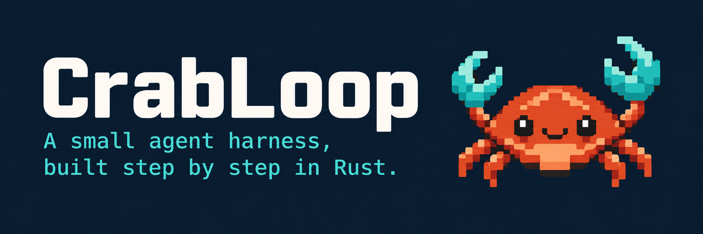
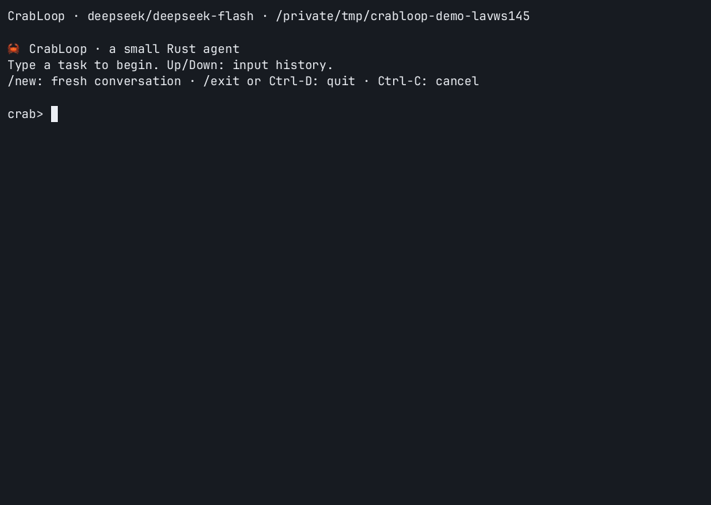

[](https://github.com/eriklee1895/crabloop/actions/workflows/ci.yml) [](Cargo.toml) [](https://github.com/eriklee1895/crabloop/tree/milestone/v1) [](tutorial/README.md)

用 Rust 从零实现一个小型 coding agent，通过读取代码、修改文件、运行测试和处理反馈，学习 agent harness 的核心机制。

[Quick Start](#quick-start) · [开始学习](#从哪里开始学习) · [路线图](docs/roadmap.md)



## Quick Start

在仓库根目录的 `.env` 中配置 `DEEPSEEK_API_KEY`，然后运行：

```bash
cargo run
```

在 `crab>` 后输入任务，按 Enter 提交。回答结束后可以继续追问，例如：

```text
crab> 读取 README.md，概括项目结构
crab> 找到 agent loop，解释工具结果怎样进入下一轮
```

`/new` 开始新对话，`/exit` 或 Ctrl-D 退出，Ctrl-C 取消当前执行。取消或报错后先检查文件状态，再用 `/new` 继续。

单次执行一个任务并退出：

```bash
cargo run -- -p "检查 README，说明这个项目能做什么"
```

配置读取启动目录的 `.env`，进程环境优先。只配置 `DEEPSEEK_API_KEY` 即可使用 DeepSeek；OpenAI 或兼容端点的配置见 [.env.example](.env.example)。更多命令行用法见 `cargo run -- --help`。

## 从哪里开始学习

第一次学习建议从 **milestone/v1** 开始，先理解最小循环，再进入上下文管理与压缩。

| 分支 | 内容 | 入口 |
|---|---|---|
| [milestone/v1](https://github.com/eriklee1895/crabloop/tree/milestone/v1) | 模型、四工具与反馈循环 | `cargo run` 终端连续对话；管道输入单任务 |
| [milestone/v2](https://github.com/eriklee1895/crabloop/tree/milestone/v2) | 上下文管理与摘要压缩 | 按 v2 教程指定的基线和命令运行 |
| main | 当前完整实现：四工具、多轮对话与上下文压缩 | `cargo run` 聊天，`-p` 单次执行 |

从[中文教程](tutorial/README.md)进入 v1 的 00–06 章，学习最小循环与连续对话，再阅读 [v2 的 context 管理与 compaction](tutorial/v2/06-context-projection.md)。也可以用[七个代码增量](tutorial/v1/patches/README.md)从空目录重建 v1。

后续版本计划加入 TOML 配置、流式输出、Skills、联网工具和会话恢复，安排见[路线图](docs/roadmap.md)。这些能力尚未实现。

## 核心源码

模型交互使用 **OpenAI Responses API**，行动循环由 Rust 手写：请求模型 → 执行工具 → 回传结果 → 继续或停止。

main 从 [src/lib.rs](src/lib.rs) 的 `Session::turn` 开始阅读，再看 [src/context.rs](src/context.rs) 怎样选择历史和压缩摘要。四个工具在 [src/tools.rs](src/tools.rs)：`read_file`、`write_file`、`edit_file` 和 `bash`。

每次会话在工作区 `.crabloop/` 中保存 JSONL 执行记录，方便观察循环。当前记录用于调试，尚不支持跨进程恢复。模型说完成后，仍需检查文件和测试结果。

## 更多文档

- [设计说明](docs/design.md)：核心契约与版本边界。
- [调试指南](docs/debugging.md)：断点、JSONL 与 HTTP 请求观察。
- [验收记录](evidence/v1/ga-review.md)与[上下文压缩实验](evidence/v2/acceptance.md)：测试和真实任务证据。
- [开发约定](AGENTS.md)：贡献方式与检查要求。
