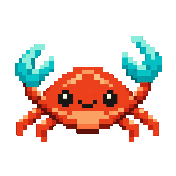

# 小螃蟹：眨眼与单钳轻挥

2026-10-14。输出：[crabloop-mascot.gif](../crabloop-mascot.gif)，256 × 256、3.9 秒、无限循环、透明背景。



## 源文件

- [静态吉祥物](../crabloop-mascot.png)：固定主体，1254 × 1254 RGBA。
- [blink-source.png](blink-source.png)：内置 imagegen 生成的闭眼关键帧，只使用眼睛区域；[实际提示词](blink-prompt.txt)。
- [frames/](frames/)：六张 256px RGBA 源帧，包含睁眼、半闭眼、闭眼和三个挥钳位置。
- [timeline.json](timeline.json)：15 段姿态与停顿时长，总计 3900ms。重复姿态复用同一张源帧。
- [scripts/render-mascot.py](../../../scripts/render-mascot.py)：本地帧组装与 GIF 导出脚本。

## 重建与修改

本次使用 Python 3 与 Pillow 12.2.0。在已安装该版本 Pillow 的环境中，从仓库根目录运行：

```bash
python3 scripts/render-mascot.py
```

脚本更新六张源帧和最终 GIF。`timeline.json` 的 `duration_ms` 控制停顿和挥动节奏，单位为毫秒，使用 10ms 的整数倍；`size` 控制输出边长。

主体始终来自静态 PNG；闭眼仅使用生成图的眼部小区域，半闭眼由原眼睛压缩到一半高度。挥动仅旋转画面右侧的钳子和上臂，角度为 -4°、-8°、+5°，其余身体与微笑保持稳定。像素图使用最近邻缩放；GIF 使用统一调色板和逐帧清屏，避免颜色跳动及透明背景残影。

GIF 透明度只有开/关两种；RGBA 源帧保留 alpha，导出时将 alpha <128 的像素设为透明。源图若替换为不同尺寸或角色位置，需要同步调整脚本中的眼部范围和钳子转轴。

首尾均为原位。检查了每帧透明角、完整钳尖/腿部、帧数/总时长、源帧中变化区域，以及浅色和深色背景的浏览器预览。生成脚本属于品牌素材工具，不参与 Agent 运行。
