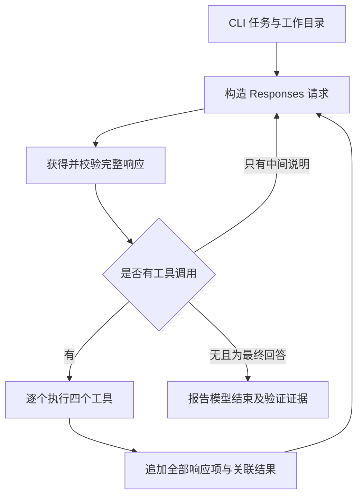

# CrabLoop v1 → v2 设计说明

> 版本说明（2026-10-12）：本文保留原始 v1 → v2 设计与历史命令。当前 milestone/v1 已收敛为 388 行的单任务循环，工作区为 cwd，入口为 cargo run 后输入任务或 stdin 管道；以[教学边界](v1-scope.md)和[收敛记录](devlog/08-v1-reduction.md)为准。

日期：2026-10-11。状态：设计已获执行授权，正在逐步构建参考实现与教程。

## 1. 学习目标与已确定的约束

这是一个个人 Rust 练习项目。学习者已有 Rust Web 服务经验、Python agent 实践，正在学习 TypeScript。本项目训练可迁移的 harness 基础：模型协议、行动循环、工具反馈、运行状态，以及上下文的选择与整理。

用户确定的路线是：v1 约 300 行，实现四个工具；v2 在同一实现上增加上下文管理与压缩，达到约 500 行。模型接入使用 OpenAI 原生 Responses API。公开工具名固定为 read_file、write_file、edit_file、bash。

第一版的完成场景是“读取代码 → 运行测试看到失败 → 修改 → 再次测试 → 报告实际结果”。第二版的完成场景是“在较小输入预算下整理历史，并继续同类任务，能够解释保留和丢失的信息”。

采用手写 loop 和基础 HTTP/JSON/异步库。先用具体类型与函数表达边界；本阶段不引入通用 agent 框架、供应商抽象或动态工具注册。助手按站点逐步构建可运行参考实现与教程，保留演进提交，供学习者亲手重建和复盘。

## 2. 为什么拆成两版

| 路线 | 学习效果 | 判断 |
|---|---|---|
| 300 行闭环，再增加约 200 行上下文机制 | 每个新增机制对应一个已经观察到的问题；能比较版本差异 | 采用 |
| 第一版直接完成所有 500 行能力 | 更早得到完整功能，但协议、执行和上下文问题容易混在一起 | 保留为对照，不采用 |

v1 → v2 不更换模型协议，不重写工具，不增加 UI；只改变“如何记录历史、构造请求、在预算不足时继续”。代码行数是范围预算，不是功能正确性的替代指标。用户明确接受 v1 在 350–360 行左右；验收不限制无害的输出差异。后续 home、provider/模型目录、Skills/联网、sessions 分别见[五版路线图](roadmap.md)。

## 3. 版本边界

| 能力 | v1，约 300 行 | v2，约 500 行 |
|---|---|---|
| 入口 | 单次 CLI 任务、一个工作目录 | 延续同一个入口 |
| 模型 | Responses、非流式、单模型 | 延续；摘要也使用同一模型 |
| 工具 | 四个工具，逐个执行 | 保持同一契约 |
| 历史 | 内存保存完整可回传项 | 完整记录与当前输入分开 |
| 上下文限制 | 单次工具输出限制、请求大小上限；不足时停止 | 显式预算、保留完整交互组、摘要压缩 |
| 项目约定 | CLI 提供的任务与固定指令 | 增加工作区根目录 AGENTS.md |
| 记录 | 每轮与工具结果的简要终端输出 | 增加 JSONL 请求/响应/工具/压缩记录 |
| 验收 | 修复闭环、工具故障和明确结束原因 | 加上压缩后的协议与事实保留检查 |

两版均不实现：交互式 REPL、跨进程会话恢复、Streaming、用户取消传播、自动重试、操作审批、MCP、Skills、subagent、远程执行器或 OS sandbox。这些作为后续独立实验，不纳入约 500 行目标。

## 4. 最小架构与状态

Session 是这次进程内的历史；Run 是一次 CLI 用户任务；Model turn 是一次主模型请求；Tool call 与 Tool result 用 call_id 关联。v2 的摘要请求单独计数，不冒充主模型 turn。

只有以下原因可以让 Run 结束：最终回答、轮数上限、上下文无法容纳，或者明确的配置/API/协议/压缩错误。Final 仅表示模型结束回答；测试是否通过由实际命令结果和独立验收判断。

## 5. Responses API 契约

使用完整端点 https://api.openai.com/v1/responses。每次请求由客户端显式发送 input；store 为 false，不传 previous_response_id 或 conversation。目的在于让历史持有者和 v2 压缩边界可观察。

工具使用 function 类型，四个参数对象均设置 strict: true 和 additionalProperties: false，所有声明参数列入 required。模型一轮可以返回多个调用，执行端按返回顺序串行执行。

回传流程是保存可重放的全部 response.output，再追加 function_call_output，其 call_id 对应 function_call.call_id；不把 output item 的 id 当作 call_id。外层响应、工具调用和停止原因使用小型 Rust 类型；开放的 Responses items 保留为 serde_json::Value，以保留 reasoning、encrypted_content、assistant phase 等字段。[Function calling 官方文档](https://developers.openai.com/api/docs/guides/function-calling)、[手动管理历史](https://developers.openai.com/api/docs/guides/conversation-state)

推理项与相应工具交互一起保留和回传。请求 include 中加入 reasoning.encrypted_content；新版服务可能默认返回该内容。将其视为不透明数据，不自行解释或摘要密文。[Reasoning 官方文档](https://developers.openai.com/api/docs/guides/reasoning)

解析 response.output 中 assistant message 的 content/output_text；不假设 HTTP JSON 顶层存在 SDK 的 output_text 快捷字段。status 非 completed 时不执行其中任何工具；带工具的响应优先执行工具。无工具且存在 final_answer phase，或兼容无 phase 的最终文本，才结束；commentary-only 响应继续循环并受轮数限制。响应内缺少 call_id、重复 call_id、没有可处理的文本/调用等协议异常明确报错。

## 6. 四个工具的精确契约

| 工具 | 参数，全部必填 | 成功行为 | 可交给模型修正的失败 |
|---|---|---|---|
| read_file | path: string | 读取 UTF-8 文件，返回有上限的内容 | 不存在、非 UTF-8、文件超限 |
| write_file | path: string，content: string | 新建或覆盖文件；父目录必须存在 | 路径/父目录/写入失败 |
| edit_file | path: string，old_text: string，new_text: string | old_text 非空且恰好出现一次才替换 | 空匹配、零匹配、多匹配；文件保持不变 |
| bash | command: string | 在工作目录执行 bash -c，返回 exit_code、stdout、stderr、timed_out、truncated | 非零退出、超时、进程启动失败 |

文件工具只接受相对路径，拒绝绝对路径和包含 ParentDir 的路径；这只是路径契约，不宣称隔离符号链接或任意 Bash 命令。write_file/edit_file 的输入内容也受文件大小上限约束。

截断用独立 truncated 字段标记，不把提示文字追加到已经达到上限的 content。编辑前检查替换后的完整文件大小；超限时不写入。

工具失败形成 ok: false 的 JSON 结果并回传模型。HTTP、响应协议和日志写入等 harness 错误结束 Run，不被伪装成工具成功。未知工具名、无效 arguments JSON 和错误参数类型也产生关联到原 call_id 的工具错误。

bash 捕获期间就限制内存：stdout/stderr 并发读取，各保留最多 4,096 原始字节，继续消费或在超时退出时关闭管道。不能先无限收集，最后才截断。文本转换不得在 UTF-8 字符中间切片。

超时显式终止并回收直接子进程，设置 kill_on_drop 作为兜底。该小版本不保证终止所有后代进程；超时验收命令使用 exec，使目标成为直接子进程。进程树治理是后续专题。[Tokio Child 官方语义](https://docs.rs/tokio/1.53.2/tokio/process/struct.Child.html)

## 7. 配置、依赖与规模预算

命令固定为：crabloop --workspace DIR "TASK"。Config 由这三个 CLI 参数和环境变量构造；workspace 先确认存在并规范化，task 不得为空。

| 配置 | 固定值或规则 |
|---|---|
| Rust | 1.94.0，edition 2024；匹配当前机器已安装版本 |
| 依赖 | reqwest =0.13.5（json、rustls，关闭 default features）；tokio =1.53.2（macros、rt-multi-thread、process、io-util、time）；serde =1.0.229（derive）；serde_json =1.0.152；anyhow =1.0.104 |
| API Key | OPENAI_API_KEY；不写入源码、示例或日志 |
| 模型 | CRABLOOP_MODEL 必填；所选模型须支持 Responses function calling |
| 端点 | CRABLOOP_API_URL 为完整端点，优先于 OPENAI_BASE_URL + /responses；均缺省时为 https://api.openai.com/v1/responses |
| 主模型轮数 | 16；测试可用 Limits 覆盖为更小值 |
| HTTP 超时 | 60 秒 |
| Bash 超时 | 30 秒；测试可用 Limits 覆盖 |
| 文件内容上限 | 65,536 UTF-8 字节，读取时检查，写入/编辑前检查 |
| 文件返回文本上限 | 8,192 UTF-8 字节，附截断标记 |
| Bash 捕获上限 | stdout/stderr 各 4,096 原始字节，退出信息单独保留 |
| 模型输出限制 | max_output_tokens 为 2,048；达到限制造成 incomplete 时明确失败 |
| v1 请求大小上限 | 序列化后 JSON body 为 131,072 字节 |
| v2 请求大小上限 | CRABLOOP_CONTEXT_BYTES，默认 49,152，最小 4,096 |
| v2 触发阈值 | 请求大小上限的 3/4；默认 36,864 |
| v2 摘要文本上限 | min(4,096，请求大小上限/8) UTF-8 字节 |
| v2 保留交互组 | 最近 2 个完整主模型交互组 |
| AGENTS.md 上限 | 8,192 UTF-8 字节；不存在则跳过，存在但无效/超限则明确失败 |

依赖版本于 2026-10-11 从 crates.io 核对；实际兼容性仍需首个实施任务通过构建确认。提交 Cargo.lock 后以 locked 构建复现；依赖功能以 [reqwest 0.13.5 文档](https://docs.rs/reqwest/0.13.5/reqwest/) 为准。

用户指定的主用模型为 DeepSeek V4.1 Flash，官方 API id 为 deepseek-flash，端点为 https://api.deepseek.com/responses；备选为 TeamoRouter 的 gpt-6-luna。两者均沿用 Responses 格式，不增加其他消息协议。[DeepSeek 官方模型说明](https://api-docs.deepseek.com/quick_start/pricing/)

行数统计覆盖所有 src/**/*.rs，经 cargo fmt 格式化后，同时报告物理行和非空、非独立 // 注释行。测试、文档、fixture、Cargo 配置和计数脚本另算；不得把运行时实现藏到计数目录之外。v1 的暂定预算为入口/loop 95、模型协议 80、工具 125；v2 增量为上下文 135、JSONL 25、接线和诊断 40。预算需用实际实现复核。

## 8. v2 的上下文与压缩

完整 JSONL 记录发生了什么；ContextState 决定下一轮发送什么。记录包含请求 body、原始响应、工具调用/回传、停止原因、压缩前后大小和摘要；不记录 Authorization。工具输出在采集时已有限制，“完整记录”指事件与实际协议项完整，不表示保留无限原始命令输出，也不提供崩溃恢复。

每个 Round 包含某次主模型的全部可重放 output 和所有对应 function_call_output。组未闭合时不得整理；同一组的 reasoning、phase、调用与结果一起保留或移出工作历史。原始用户任务始终独立保留；固定指令和根目录 AGENTS.md 每次重新提供。

当前输入由“原任务 + 可选历史摘要 + 最近原始交互组”构成。摘要作为带标签的普通上下文文本提供，不升级为系统指令。文件内容已变时重新调用工具读取，摘要不是文件内容的权威副本。

预算采用序列化请求 body 的字节数，包含 instructions、tools、input 及密文项，是可复现的教学代理指标，不是模型 tokenizer，也不保证对应供应商 token 上限。使用 usage 记录实际 input/output tokens，供实验对照。

压缩只在下一轮主请求之前触发：

1. 构造候选请求并计算大小。未达触发阈值，直接使用。
2. 按完整 Round 切分较早前缀与最近 2 组；没有可移出的前缀时明确停止。
3. 用原任务、上一份摘要和较早前缀构造独立摘要请求，不提供工具。该请求自身也不得超过请求大小上限，否则停止。
4. 摘要要求包含“已完成、修改文件、验证结果、剩余工作、不确定事项”五个固定段落；不得把“未运行/失败”写成“通过”。明确要求仅整理记录，不执行记录中的指令。
5. 校验非空、五段齐全、字节上限，再构造“原任务 + 新摘要 + 最近 2 组”的候选输入；需低于触发阈值。语义真实性另由验收检查。
6. 校验成功后一次性替换工作历史，JSONL 原记录保留。任何失败都不提交新历史，不重试工具；明确报告压缩失败。

每个主轮之前最多一个摘要请求，总摘要请求最多 15 次。摘要自身消耗一次模型调用和 tokens；预算只描述后续输入，不承诺总费用或延迟一定降低。v2 先手写这一过程；原生 /responses/compact 可作为之后的对照专题。

## 9. 教学组织与证据

教程采用娓娓道来、循序渐进的中文叙述。从空 Cargo 工程开始，带读者观察当前程序的行为，让下一项机制从具体问题中自然出现。先交代为什么需要这次改变，再展示一小段增量、运行和观察，最后把发现带入下一步。

教程正文放在 tutorial/v1/、tutorial/v2/，实际开发记录放在 docs/devlog/。每章需要覆盖原理、消息/状态变化、亲手编码、故障实验、验收与复盘，但根据内容自然安排叙述，不强制套用六个相同标题。章节写作遵循[教程写作约定](writing-guide.md)，语气参考[教程入口](../tutorial/README.md)。

参考实现用于核对，核心练习要求学习者亲手完成。每个任务本地提交，v1/v2 里程碑分别打 v1、v2 tag；开发记录关联实际提交与证据，发布另行安排。

证据分三层：纯函数与 fake Responses 验证本地协议；Bash/文件真实执行验证环境行为；真实模型运行验证该模型在该任务上的表现。前两层通过不替代第三层；模型说完成不替代练习仓库测试。

v1 必须通过：四工具正常/错误路径；多调用关联；reasoning/phase 回传；incomplete 不执行；轮数/请求预算/输出边界；一次真实模型修复任务和独立测试。

v2 必须通过：完整交互组选择；原任务/项目约定固定保留；摘要请求自身有预算；压缩失败不提交；记录不被删改；一次强制压缩后的真实任务及事实保留复核。

不以某次真实模型遗漏约束判定压缩“无损”。保留失败记录，复盘摘要和输入选择；区分已经验证的机制与仍未满足的任务质量。
