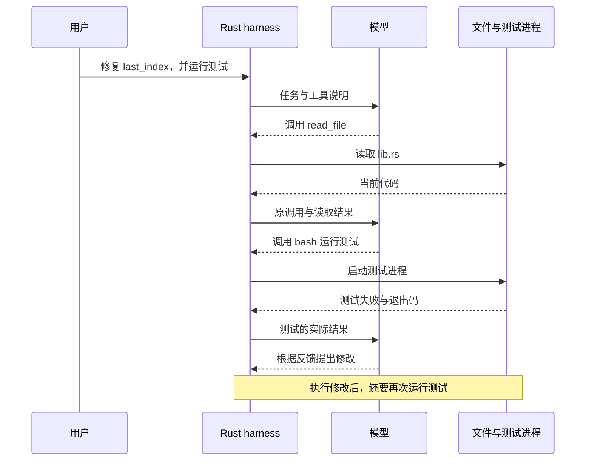

# 00：先看清一次修复是怎样发生的

项目里有一个函数，用来返回集合中最后一个元素的下标。长度为 3，答案应该是 2；集合为空，就没有合法下标。现在它却把长度直接当成了下标：

```rust
pub fn last_index(len: usize) -> Option<usize> {
    Some(len)
}
```

这个函数来自 `fixtures/buggy-rust/lib.rs`。先不用动它。我们希望 CrabLoop 能接过这样一句话：“找到这个问题，修好它，再运行测试。”在写第一段网络代码之前，先沿着这句话走一遍。

## 模型说要读文件时，文件还没有被读取

程序把任务发给模型。模型可能直接回答，也可能提出一个动作，例如调用 `read_file`，参数是 `lib.rs`。

此时我们拿到的仍然只是一份数据。磁盘上的文件还在那里，没人读过它。接下来，Rust 程序要找到对应的工具函数，真正读取文件，再把内容放进下一次请求。模型看到文件以后，才有机会提出修改或运行测试。

我们把负责这些来回的程序叫作 **harness**。它持有历史、执行工具、收集结果，并按约定继续请求或停止。

下面是一次修复的简化示意，省略了读取测试文件等细节；它不是某次真实模型运行的转录：



图里每一条指向文件或测试进程的箭头，都由 harness 发出。模型负责提出下一步，工具负责与环境打交道。文件内容、进程输出和退出码，随后又成为模型能够使用的新信息。

现在试着把最后一段补上：修改以后，该由谁运行测试？谁把结果送回模型？如果模型说“测试通过了”，我们应该去哪里找支持这句话的事实？

## 先把循环装进几行伪代码

后面几章会分别实现图中的不同部分。先看一个不要求编译的阅读地图：

```text
history = [用户任务]
重复，直到达到轮数上限：
    reply = 请求模型(history, 工具描述)
    history += reply 的完整输出
    如果没有工具调用，而且这是最终回答：结束
    对每个工具调用：
        result = 真正执行工具
        history += 带原 call_id 的结果
```

先盯住 `history`。第一次请求时，它可能只有用户的一句话；等工具执行过，里面就多了原调用、文件内容或测试结果。下一次请求读取的是增长后的历史，因此有机会作出不同的决定。

第 04 章会把这几行变成真正的 Rust 函数 `run_turn`，几乎一行对应一行。用户输入的下一句话怎样接进同一份 `history`，留到第 06 章再看。

## 给这几种动作取名字

一次用户任务从开始到停止，可以叫作一个 **Run**。每请求一次模型，是一个 **Model turn**。一份响应可能包含多个 **Tool call**，每个调用都需要对应的 **Tool result**。

别急着背这些名字，先把它们放回图中：一次修复任务，可能需要好几次模型请求；一次模型请求，也可能同时带回“读代码”和“读测试”两个动作。

`call_id` 用来把调用与结果接起来。假设模型连续读两次 `lib.rs`，第一次发生在修改前，第二次发生在修改后。工具名和路径都一样，内容却可能不同；两个调用各自的 `call_id` 才能说明结果属于哪一次。

后面这些区别会逐渐变成 Rust 类型。等代码需要表达“工具失败”和“整个任务结束”时，我们再看 `Result` 和 `enum` 怎样帮忙。

## 准备一个可以放心试错的地方

参考仓库保存完整实现。亲手跟做时，我们另建一个空练习目录，按[增量入口](patches/README.md)记住这两个位置。后续实验会使用临时文件或专门的 `playground` 副本，不会碰参考仓库里的源码。

教程的代码基于 Rust 1.94、edition 2024，Bash 工具会显式启动 Bash。可以先用 `rustc --version`、`cargo --version` 和 `bash --version` 确认这些命令可用。

需要真实模型的实验只用三个环境变量：`OPENAI_API_KEY`、`OPENAI_BASE_URL` 和 `CRABLOOP_MODEL`。第 01 章会在第一次用到时设置它们，之后每章沿用。

第一步不需要做出一个完整 agent。我们只要发出一条请求，再看清响应里装着什么。进入[第 01 章：把第一条请求送出去](01-responses.md)。
