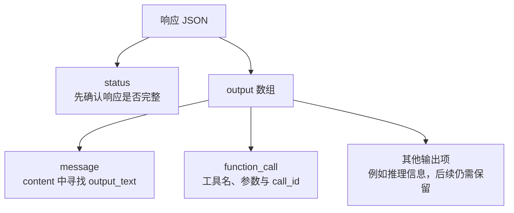
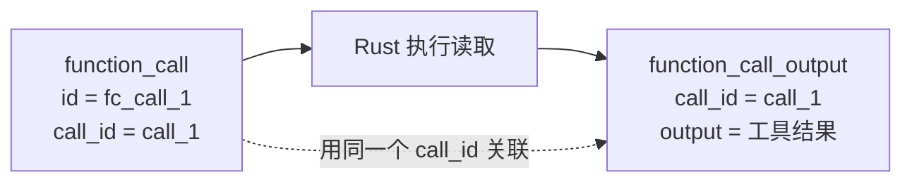

# 01：把第一条请求送出去

上一章里，我们跟着一个修复任务走过了模型、工具和反馈。现在把这张地图暂时折小一点，只留下最短的一段：发出请求，拿到响应，看看里面到底是什么。

这一章结束时，程序还不会替你读文件。它会先听懂两种回答：“这是一段文字”，以及“请调用这个工具”。文件操作留到下一章接上。

## 先做一个只跑一次的小探针

先在参考仓库根目录记住它的位置，再创建独立的练习工程。目录可以叫 `crabloop-lab`，Cargo 包名保持 `crabloop`，后面的测试会使用这个名字：

```bash
export CRABLOOP_SOURCE="$PWD"
mkdir -p playground
cargo new playground/crabloop-lab --name crabloop --edition 2024
cd playground/crabloop-lab
git init -q
```

也可以按[增量入口](patches/README.md)应用 `00-probe.patch`，直接得到包含锁文件的同一探针。两种方式任选一种，接下来都在练习目录操作。

把 `Cargo.toml` 的 dependencies 部分替换为：

```toml
[dependencies]
anyhow = "=1.0.104"
reqwest = { version = "=0.13.5", default-features = false, features = ["json", "rustls"] }
serde = { version = "=1.0.229", features = ["derive"] }
serde_json = "=1.0.152"
tokio = { version = "=1.53.2", features = ["macros", "rt-multi-thread", "process", "io-util", "time"] }
```

`reqwest` 发送 HTTP 请求，`serde_json` 处理 JSON，`tokio` 让程序能够等待网络。其余依赖和进程相关 feature 会在后面用到，先不需要逐个展开。

现在把 `src/main.rs` 替换为下面这个完整程序：

```rust
use serde_json::{Value, json};

#[tokio::main]
async fn main() -> anyhow::Result<()> {
    let key = std::env::var("OPENAI_API_KEY")?;
    let model = std::env::var("CRABLOOP_MODEL")?;
    let base = std::env::var("OPENAI_BASE_URL")?;
    let client = reqwest::Client::builder()
        .timeout(std::time::Duration::from_secs(60))
        .build()?;
    let response: Value = client
        .post(format!("{}/responses", base.trim_end_matches('/')))
        .bearer_auth(key)
        .json(&json!({
            "model": model, "input": "只回复 CRABLOOP_PROTOCOL_OK",
            "store": false, "max_output_tokens": 2048
        }))
        .send().await?
        .error_for_status()?
        .json().await?;
    println!("{}", serde_json::to_string_pretty(&response)?);
    Ok(())
}
```

读这段代码时，先沿着动作走：取配置 → 创建客户端 → 发送 JSON → 检查 HTTP 状态 → 解码响应 → 打印。`?` 会把某一步的失败交给入口，避免带着错误继续向下；`.await` 则等待网络操作完成。

先运行 `cargo check`。手写工程会在这一步生成 `Cargo.lock`，以后带上 `--locked`，保持解析后的依赖版本一致。

## 让它真的说一句话

探针读取三个进程环境变量：`OPENAI_API_KEY`、`OPENAI_BASE_URL` 和 `CRABLOOP_MODEL`。此阶段还不会自动加载 `.env`。

以 DeepSeek 为例，模型名使用 `deepseek-flash`，URL 前缀使用 `https://api.deepseek.com`，对应密钥放入本章通用的 `OPENAI_API_KEY`。先在自己的终端配置密钥，再运行：

```bash
export OPENAI_BASE_URL=https://api.deepseek.com
export CRABLOOP_MODEL=deepseek-flash
cargo run --locked
```

这是会访问真实服务的手动实验。我们的请求要求只回复 `CRABLOOP_PROTOCOL_OK`，但程序打印的是整个 JSON。第一次看到一大段响应时，不用逐字段阅读，先找到 `output`：



正常文字回答会出现在 `message` 的 `content` 中，对应类型是 `output_text`。下面只是省略其他字段的**结构示意**，不是一次真实运行的转录：

```json
{
  "status": "completed",
  "output": [{
    "type": "message",
    "role": "assistant",
    "content": [{"type": "output_text", "text": "CRABLOOP_PROTOCOL_OK"}]
  }]
}
```

现在能回答一个小问题了：程序得到的是 HTTP JSON；最终文字藏在输出数组里面。不能想当然地把整个响应当成字符串，也不能假设 HTTP JSON 顶层一定有 SDK 那样的文本快捷属性。

## 从“打印响应”走到“理解响应”

接下来应用 [01-responses.patch](patches/01-responses.patch)。如果刚才手写探针与补丁起点有排版差异，可以参照 diff 逐文件修改；完整增量包含所有新增文件。

```bash
git apply --check "$CRABLOOP_SOURCE/tutorial/v1/patches/01-responses.patch"
git apply "$CRABLOOP_SOURCE/tutorial/v1/patches/01-responses.patch"
cargo test --locked --test protocol
```

`CRABLOOP_SOURCE` 指向参考仓库，设置方法见[增量入口](patches/README.md)。代码到达 `step-01-responses`：`src/main.rs` 负责接收配置，`src/model.rs` 的 `ModelClient` 构造请求、校验响应，`ToolCall` 和 `ModelReply` 保存解析后的结果。

在 `ModelClient::request` 中，`instructions` 放程序约定，`input` 放任务与历史，`tools` 放工具说明。本阶段 `tools` 为空，尚未连接真实工具。请求设置 `store: false`，由我们显式保存并发送历史；这会让第 04 章的循环更容易观察。

这些协议测试会启动本地 HTTP 服务，不需要模型密钥。它先返回我们准备好的 JSON，程序仍然经过真正的发送、接收和解析过程。这样可以稳定检查请求是否带对了字段，也能制造真实服务不一定恰好返回的错误。

这个阶段的命令行入口已经接收任务。沿用刚才的三个环境变量，可以运行：

```bash
cargo run --locked -- --workspace . "只回复 CRABLOOP_PROTOCOL_OK"
```

这是本章的阶段入口。最终 v1 的 stdin 输入和 `.env` 配置会在第 05 章接上，不要把两套启动方式混用。

## 如果回答是一张“动作单”

再看测试样本中的另一种输出：

```json
{
  "type": "function_call",
  "id": "fc_call_1",
  "call_id": "call_1",
  "name": "read_file",
  "arguments": "{\"path\":\"lib.rs\"}"
}
```

这份数据说的是：“请读取 `lib.rs`。”它没有包含文件内容，也没有替我们执行读取。

先留意 `arguments`：它是一个字符串，字符串内部才是一份 JSON。响应解析先认出工具调用，下一章的执行入口再解开参数、验证路径。两个步骤各自处理不同的错误。

再看两个相似的名字：`id` 标识这一个输出项；`call_id` 用来关联稍后返回的工具结果。后续的对应关系会像这样：



打开 `src/model.rs`：`ToolCall` 保存执行所需的 `call_id`、`name` 和 `arguments`；`ModelReply` 同时保留完整 `output`。前者方便执行动作，后者留给下一轮重放历史。即使其中有我们不解读的推理内容，也不能只因为“暂时用不上”就丢掉它。

## 先确认完整，再决定做什么

如果响应在生成途中被截断，里面可能已经出现了一部分工具调用。这时急着执行，动作可能基于一份不完整的回答。

因此解析器先检查响应状态，再处理输出项。运行下面的实验，观察不完整响应、缺失 `call_id` 和重复 `call_id` 怎样被拒绝：

```bash
cargo test --locked --test protocol incomplete_and_missing_or_duplicate_call_ids_are_rejected -- --exact
```

另外，只有中间说明 `commentary` 的响应也不能当成最终回答。它可以留在历史里，但 `ModelReply.is_final` 应为 false。第 04 章会用这个判断决定是否继续循环。

这些测试确认客户端如何处理约定好的响应；前面的手动请求则检查你的真实服务能否完成一次往返。带着这个区别继续：现在我们能认出 `read_file` 这份动作单了，下一章让它真正读到磁盘上的文件。

下一章：[02：让一个工具调用真正读到文件](02-file-tools.md)。本章固定源码见 [`step-01-responses` 的 model.rs](https://github.com/eriklee1895/crabloop/blob/step-01-responses/src/model.rs)。
