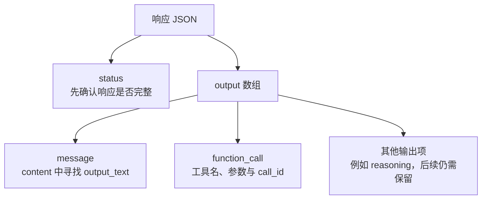
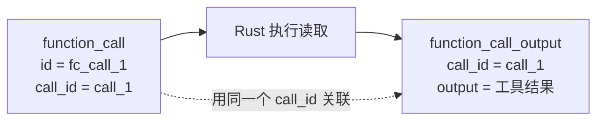

# 01：把第一条请求送出去

上一章里，我们跟着一个修复任务走过了模型、工具和反馈。现在把这张地图暂时折小一点，只留下最短的一段：发出请求，拿到响应，看看里面到底是什么。

这一章结束时，程序还不会替你读文件。它会先听懂两种回答：“这是一段文字”，以及“请调用这个工具”。文件操作留到下一章接上。

## 从一个空目录开始

按[增量入口](patches/README.md)准备好练习目录 `playground/v1-lesson`，并复制了 `Cargo.lock` 以后，应用本章补丁：

```bash
git apply --check "$CRABLOOP_SOURCE/tutorial/v1/patches/01-responses.patch"
git apply "$CRABLOOP_SOURCE/tutorial/v1/patches/01-responses.patch"
cargo test --locked --test protocol
```

补丁建立了一个名为 `crabloop` 的 Cargo 工程。先看 `Cargo.toml` 的依赖：

```toml
[dependencies]
anyhow = "=1.0.104"
reqwest = { version = "=0.13.5", default-features = false, features = ["json", "rustls"] }
serde = { version = "=1.0.229", features = ["derive"] }
serde_json = "=1.0.152"
tokio = { version = "=1.53.2", features = ["macros", "rt-multi-thread", "process", "io-util", "time"] }
```

`reqwest` 发送 HTTP 请求，`serde`/`serde_json` 处理 JSON，`tokio` 让程序能够等待网络和子进程，`anyhow` 让错误带着上下文一路返回。这就是 v1 全部的依赖，后面不再增加。

本章写下的代码分在两个文件里：`src/lib.rs` 放配置，`src/model.rs` 放和模型对话的两个函数。另外还有一个小探针 `examples/probe.rs`，用来亲眼看一次真实响应。

## 程序需要知道的三件事

在发请求之前，程序要知道：请求发到哪里、用哪把钥匙、请哪个模型回答。`src/lib.rs` 的 `Config::from_env` 从环境变量读出这些信息：

```rust
pub fn from_env() -> Result<Self> {
    let var = |key: &str| std::env::var(key).ok().filter(|v| !v.trim().is_empty());
    let base = var("OPENAI_BASE_URL").unwrap_or_else(|| "https://api.openai.com/v1".into());

    Ok(Self {
        endpoint: format!("{}/responses", base.trim_end_matches('/')),
        api_key: var("OPENAI_API_KEY").context("OPENAI_API_KEY is required")?,
        model: var("CRABLOOP_MODEL").context("CRABLOOP_MODEL is required")?,
        workspace: std::env::current_dir()?,
    })
}
```

`var` 是一个小闭包：变量不存在或为空，都得到 `None`。`OPENAI_BASE_URL` 可以省略，默认是 OpenAI；密钥和模型名必须提供，缺了就用 `context` 给出一句明确的错误，再由 `?` 交还给调用者。程序不根据模型名猜测服务地址，选哪家服务完全由这三个变量决定。

`workspace` 是启动程序时所在的目录。现在还用不上，下一章的文件工具会以它为根解析路径。

## 让它真的说一句话

以 DeepSeek 为例，在自己的终端设置三个变量：

```bash
export OPENAI_API_KEY=你的密钥
export OPENAI_BASE_URL=https://api.deepseek.com
export CRABLOOP_MODEL=deepseek-flash
```

使用 OpenAI 时省略 `OPENAI_BASE_URL`，模型名换成你账号可用的模型。任何支持 Responses API 和 function calling 的服务都可以，只要换掉这三个值。后面每章的真实实验都沿用这一组变量。

然后运行探针：

```bash
cargo run --locked --example probe -- "只回复 CRABLOOP_PROTOCOL_OK"
```

这是会访问真实服务的手动实验。探针把任务包成一条用户消息，调用 `model::request` 和 `model::respond`，再把响应中的 `output` 数组打印出来。第一次看到它时，不用逐字段阅读，先认出每一项的 `type`：



正常文字回答出现在 `message` 的 `content` 中。下面是省略了其他字段的**结构示意**，不是一次真实运行的转录：

```json
{
  "status": "completed",
  "output": [{
    "type": "message",
    "role": "assistant",
    "content": [{"type": "output_text", "text": "CRABLOOP_PROTOCOL_OK"}]
  }]
}
```

最终文字藏在输出数组里面。不能想当然地把整个响应当成字符串，也不能假设 HTTP JSON 顶层一定有 SDK 那样的文本快捷属性。

## 一次请求里装了什么

打开 `src/model.rs`。`request` 只是把几样东西拼成一份 JSON：

```rust
pub fn request(config: &Config, input: &[Value]) -> Value {
    json!({
        "model": config.model,
        "instructions": INSTRUCTIONS,
        "input": input,
        "store": false,
        "include": ["reasoning.encrypted_content"],
        "max_output_tokens": 131_072
    })
}
```

`instructions` 放程序的固定约定，`input` 放任务与历史。`store: false` 表示服务端不替我们保存对话，历史由我们自己保存、每次完整发送；第 04 章的循环会因此很容易观察。`include` 要求服务把推理内容以加密形式返回，我们不解读它，只负责原样带回下一次请求。

`input` 的类型是 `&[Value]`：函数只借用历史来构造请求，不拿走它。现在还没有工具说明，下一章会在这份 JSON 里加上一行 `"tools"`。

## 从“打印响应”走到“理解响应”

`respond` 发出请求并检查 HTTP 状态，然后把响应解码成一个很小的结构：

```rust
#[derive(Deserialize)]
struct Response {
    status: String,
    output: Vec<Value>,
}
```

只取两个字段。`output` 保留为 `Vec<Value>`，也就是原样的 JSON：里面可能有我们不认识、也不打算解读的项，但下一次请求还要把它们完整送回去。

至于我们需要读懂的那几种项，用一个 `enum` 描述它们的形状：

```rust
#[derive(Deserialize)]
#[serde(tag = "type", rename_all = "snake_case")]
enum Item {
    FunctionCall(ToolCall),
    Message { role: String, content: Vec<Content>, phase: Option<String> },
    #[serde(other)]
    Other,
}
```

`#[serde(tag = "type")]` 让 serde 按每一项的 `type` 字段选择分支：`function_call` 变成 `Item::FunctionCall`，`message` 变成 `Item::Message`，其他任何类型都落进 `Other`。这几行几乎就是上面那张图的 Rust 写法。

message 内的 content 也按 `type` 区分，只把 `output_text` 的 `text` 当作文字。该字段缺失时返回解析错误；其他 content 项仍随原始 output 保留：

```rust
#[derive(Deserialize)]
#[serde(tag = "type", rename_all = "snake_case")]
enum Content {
    OutputText { text: String },
    #[serde(other)]
    Other,
}
```

`respond` 随后逐项匹配，只从 assistant 的最终 message 中收集文字。同一响应中的工具调用 ID 必须非空且唯一：

```rust
let mut ids = HashSet::new();
for item in &response.output {
    match Item::deserialize(item)? {
        Item::FunctionCall(call) => {
            ensure!(
                !call.call_id.trim().is_empty() && ids.insert(call.call_id.clone()),
                "invalid or duplicate call_id"
            );
            calls.push(call);
        }
        Item::Message { role, content, phase } => {
            if role == "assistant" && phase.as_deref().is_none_or(|p| p == "final_answer") {
                final_text.extend(content.into_iter().filter_map(|part| match part {
                    Content::OutputText { text } => Some(text),
                    Content::Other => None,
                }));
            }
        }
        Item::Other => {}
    }
}
```

`Item::deserialize(item)` 从借用的 `&Value` 读出需要的字段，原来的 `output` 保持不变。最后它返回一个 `Reply`：

```rust
pub struct Reply {
    pub output: Vec<Value>,
    pub calls: Vec<ToolCall>,
    pub final_text: Option<String>,
}
```

`calls` 方便执行动作，`output` 留给下一轮重放历史，`final_text` 只有在模型给出最终回答时才是 `Some`。用 `Option` 而不是“一个字符串加一个布尔值”，是让“没有最终回答”成为一种类型上就看得见的状态。

## 如果回答是一张“动作单”

再看测试样本 `tests/fixtures/responses/two_calls.json` 中的一项：

```json
{
  "type": "function_call",
  "id": "fc_call_1",
  "call_id": "call_1",
  "name": "read_file",
  "arguments": "{\"path\": \"lib.rs\"}"
}
```

这份数据说的是：“请读取 `lib.rs`。”它没有包含文件内容，也没有替我们执行读取。

先留意 `arguments`：它是一个字符串，字符串内部才是一份 JSON。`ToolCall` 先把它原样保存为 `String`，下一章的工具入口再解开参数、验证路径。两个步骤各自处理不同的错误。

再看两个相似的名字：`id` 标识这一个输出项；`call_id` 用来关联稍后返回的工具结果。`ToolCall` 只取 `call_id`、`name`、`arguments` 三个字段：



如果一个 `function_call` 缺少 `call_id`，`Item::deserialize` 会直接失败。空白或重复 ID 则由后面的检查拒绝。结果需要明确对应某个调用，因此这些检查放在执行工具之前。

```bash
cargo test --locked --test protocol empty_and_duplicate_call_ids_are_rejected -- --exact
cargo test --locked --test protocol only_assistant_output_text_can_be_a_final_answer -- --exact
cargo test --locked --test protocol output_text_requires_its_text_field -- --exact
```

## 先确认完整，再决定做什么

如果响应在生成途中被截断，里面可能已经出现了一部分工具调用。这时急着执行，动作可能基于一份不完整的回答。因此 `respond` 在处理任何输出项之前先检查：

```rust
ensure!(response.status == "completed", "response status is {}", response.status);
ensure!(!response.output.is_empty(), "response has no output");
```

本章的协议测试会启动一个本地 HTTP 服务，按顺序返回准备好的 JSON。程序仍然经过真正的发送、接收和解析，所以不需要模型密钥，也能稳定制造真实服务不一定恰好返回的情况。运行下面的实验，观察不完整响应、缺少 `call_id`、空输出和 HTTP 500 怎样变成错误：

```bash
cargo test --locked --test protocol incomplete_missing_call_id_empty_output_and_http_500_are_errors -- --exact
```

另外，只有中间说明 `commentary` 的响应也不能当成最终回答。它可以留在历史里，但 `final_text` 是 `None`；没有 `phase` 字段的旧式文本则仍算最终回答：

```bash
cargo test --locked --test protocol commentary_is_preserved_and_not_final_but_phaseless_text_is -- --exact
```

第 04 章会用 `final_text` 决定循环是否结束。

这些测试确认客户端如何处理约定好的响应；前面的探针则检查你的真实服务能否完成一次往返。带着这个区别继续：现在我们能认出 `read_file` 这张动作单了，下一章让它真正读到磁盘上的文件。

下一章：[02：让一个工具调用真正读到文件](02-file-tools.md)。
