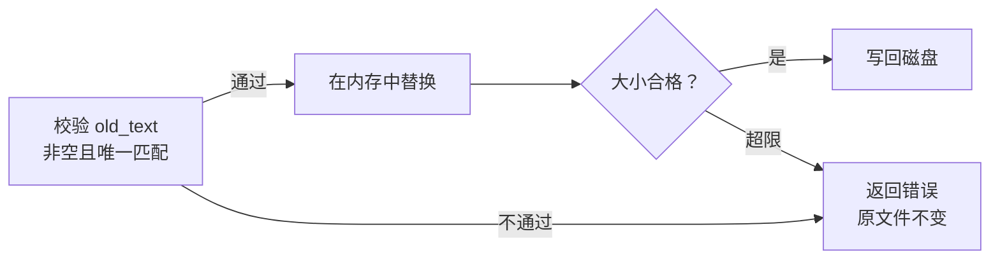

# 02：让一个工具调用真正读到文件

上一章里，模型可以返回一张动作单：工具叫 `read_file`，参数里写着文件路径。可这张单子交到程序手里以后，什么也没有发生。

这一章我们亲手实现接单的那段 Rust 代码。目标很具体：给它一个真实文件，拿回内容；再给它一次含糊的编辑，确认它会拒绝，而且没有把文件改坏。

## 先让模型看见工具

在练习目录应用[本章完整增量](patches/02-file-tools.patch)。它新增 `src/tools.rs` 和对应测试，并在 `src/lib.rs` 加上 `pub mod tools;`。

```bash
git apply --check "$CRABLOOP_SOURCE/tutorial/v1/patches/02-file-tools.patch"
git apply "$CRABLOOP_SOURCE/tutorial/v1/patches/02-file-tools.patch"
cargo test --locked --test tools
```

`src/model.rs` 的 `request` 里也多了一行：

```rust
"tools": crate::tools::schemas(),
```

`schemas` 向模型说明工具叫什么、接受哪些字段。每个工具都是一个 `function`，参数都是字符串，全部必填，并设置 `strict: true` 与 `additionalProperties: false`，让模型按约定的形状填写参数。

现在可以用上一章的探针做一个小实验。沿用那三个环境变量，在练习目录运行：

```bash
cargo run --locked --example probe -- "读取 Cargo.toml，告诉我包名"
```

这是会访问真实模型的手动实验，模型的选择可能不同。多数时候，你会在打印的 `output` 里看到一个 `function_call`，名字是 `read_file`，参数里写着 `Cargo.toml`；探针最后报告 `tool calls: 1`、`final text: None`。

模型提出了动作，可是 `Cargo.toml` 没有被任何人读过。探针只请求一次就结束了。接下来写的，就是真正去读的那段代码。

## 先写进去，再读回来

先从一条顺利的路径开始：

```bash
cargo test --locked --test tools write_then_read_roundtrip -- --exact
```

这个测试在临时目录里通过 `write_file` 写入“你好 🦀”，再直接读取磁盘核对写入确实发生，最后通过 `read_file` 把内容读回来。

所有工具调用都从 `tools::execute` 进入。它把内部的 `Result` 收成一份 JSON：

```rust
pub async fn execute(call: &ToolCall, config: &Config) -> Value {
    dispatch(call, config)
        .await
        .unwrap_or_else(|error| json!({"ok": false, "error": format!("{error:#}")}))
}
```

`execute` 永远返回一个 `Value`，不会让工具失败变成整个程序的错误。成功时是 `{"ok": true, ...}`，失败时是 `{"ok": false, "error": "..."}`。这份结果稍后会原样交给模型，让它根据错误原因调整下一步。

真正的分派在 `dispatch` 中。它先把字符串形式的参数解析成 JSON，再按工具名选择分支：

```rust
let args: Value = serde_json::from_str(&call.arguments)?;
let arg = |key: &str| args[key].as_str().with_context(|| format!("{key} must be a string"));
let path = || resolve(&config.workspace, arg("path")?);

match call.name.as_str() {
    "read_file" => {
        let text = read(&path()?)?;
        let (content, truncated) = clip(&text, READ_BYTES);
        Ok(json!({"ok": true, "content": content, "truncated": truncated}))
    }
    "write_file" => write(&path()?, arg("content")?),
    // edit_file 见下一节
    name => bail!("unknown tool: {name}"),
}
```

`arg` 从参数里取一个字符串字段，字段不存在或类型不对就返回错误。它返回借用的 `&str`，文本仍由 `args` 持有，不必为了取一个参数就复制整段字符串。`match` 的每个分支对应 `schemas` 里的一个工具，读代码时可以一一对上。

`path` 把参数交给 `resolve`，相对于工作目录解析：

```rust
fn resolve(workspace: &Path, relative: &str) -> Result<PathBuf> {
    let relative = Path::new(relative);
    ensure!(
        !relative.is_absolute() && !relative.components().any(|c| c == Component::ParentDir),
        "path must be relative without parent traversal"
    );
    let path = workspace.join(relative);
    ensure!(!path.exists() || path.is_file(), "path must be a regular file");
    Ok(path)
}
```

绝对路径和 `..` 会被拒绝，让 `path` 的含义保持明确；目录、管道这类不是普通文件的路径也会被拒绝，避免读写时卡住。符号链接和 Bash 等执行能力仍有另外的边界，这个检查是路径约定，不能当作操作系统沙箱。

## 只想改一处，为什么不能直接替换

`write_file` 适合创建文件，或者明确地用完整内容覆盖文件。可如果只想改一个名字，让模型重新输出整个文件就有些费劲了。

因此我们加入 `edit_file`：给出一段旧文本，再给出替换后的文本。例如把：

```text
prefix OLD suffix
```

改成：

```text
prefix NEW suffix
```

如果 `OLD` 只出现一次，改动位置很清楚。现在换一个文件，内容是 `same same`。模型要求把 `same` 改成 `new`，究竟应该改左边还是右边？

我们的处理是把这个歧义交回去，让调用者提供更具体的片段。`edit_file` 分支这样判断：

```rust
"edit_file" => {
    let (path, old) = (path()?, arg("old_text")?);
    ensure!(!old.is_empty(), "old_text must not be empty");
    let mut text = read(&path)?;
    let start = text.find(old).context("old_text did not match; read the file again")?;
    ensure!(text.rfind(old) == Some(start), "old_text must have a unique match");
    text.replace_range(start..start + old.len(), arg("new_text")?);
    write(&path, &text)
}
```

`find` 与 `rfind` 分别寻找最前和最后的匹配位置。两者相同，才说明位置唯一；重叠的匹配也会被发现，例如在 `aaaa` 中寻找 `aaa`。

下面把编辑分支从内存到磁盘的过程展开。注意最末尾的写回：



运行这两个实验，分别观察明确的编辑和被拒绝的编辑：

```bash
cargo test --locked --test tools edit_unique_match_changes_only_the_requested_text -- --exact
cargo test --locked --test tools failed_edits_leave_the_original_file_unchanged -- --exact
```

第二个测试会尝试多匹配、重叠匹配、零匹配和空文本。每次不仅检查 `ok: false`，还重新读取磁盘，确认原内容没有变化。

这些验证失败都发生在写回之前。最后的文件写入仍是普通文件操作；写入期间的 I/O 故障没有原子回滚保证。

## 一个中文字符，不能只留下半个

文件工具还有一个很容易亲手碰到的问题：输出太长时，我们想只保留前面一部分。但 Rust 字符串是 UTF-8，字节位置不一定是字符边界。

例如“你好🦀”占 10 个字节。如果输出预算是 7 字节，切下来的最后一个字节会落在螃蟹字符中间：

```text
字节范围：  0──2    3──5    6────9
字符：       你       好       🦀
7 字节上限：保留前 6 字节，再碰到 🦀 的第一个字节
合法截断：   你好
```

标准库的 `floor_char_boundary` 正好回答“不超过这个字节数的最后一个字符边界在哪里”。`clip` 用它截取，并告诉调用者是否截断：

```rust
pub fn clip(text: &str, max_bytes: usize) -> (&str, bool) {
    let end = text.floor_char_boundary(max_bytes);
    (&text[..end], end < text.len())
}
```

返回的 `&str` 借用原文本，不复制。模型拿到的文字能正常解码，也从 `truncated` 字段知道内容不完整。

文件本身的大小限制是另一件事。读取时先看文件有多大，再尝试 UTF-8 解码；写入前同样检查长度：

```rust
fn read(path: &Path) -> Result<String> {
    ensure!(fs::metadata(path)?.len() <= FILE_BYTES as u64, "file exceeds size limit");
    Ok(fs::read_to_string(path)?)
}
```

先判大小，是为了让“文件太大”和“编码损坏”各自得到正确的错误。一个过大的合法中文文件，应该被报告为太大，而不是被误报成编码问题。

```bash
cargo test --locked --test tools read_truncation_is_utf8_safe_and_non_utf8_is_an_error -- --exact
cargo test --locked --test tools size_limit_is_checked_before_decoding_and_before_writing -- --exact
```

前一个实验检查合法截断与真正的非法编码；后一个用一个超过 64 KiB 的中文文件，确认报告的是大小错误，过大的写入也不会改动原文件。这样，模型才有机会根据错误内容采取正确的下一步。

## 把成功和失败都变成结果

再运行一次全部文件工具测试：

```bash
cargo test --locked --test tools
```

其中 `bad_arguments_paths_and_unknown_tools_become_tool_errors` 把错误的参数类型、`..` 路径、绝对路径、不存在的文件、未知工具名和无法解析的参数 JSON 都交给 `execute`。每一种都得到 `ok: false` 和一句原因，没有一种让程序退出。

现在工具能读、能写、能精确地改，却还没有办法确认改完以后程序是否真的正确。试着解释：一次编辑为什么被拒绝，原文件何时才会改变，`execute` 为什么从不返回 `Err`。随后进入[第 03 章：让测试作为一个真实进程运行](03-bash.md)。
