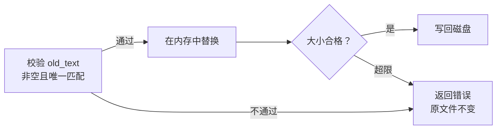

# 02：让一个工具调用真正读到文件

上一章里，模型可以返回一张动作单：工具叫 `read_file`，参数里写着文件路径。现在我们把模型暂时放在一边，亲手实现接单的那段 Rust 代码。

目标很具体：给它一个真实文件，拿回内容；再给它一次含糊的编辑，确认它会拒绝，而且没有把文件改坏。

> 本章从 `step-01-responses` 走到 `step-02-file-tools`。工具入口是 `src/tools.rs` 的 `execute`，结果暂时用 `ToolResult` 包装；第 05 章会整理为最终接口。

## 先写进去，再读回来

在练习目录应用[本章完整增量](patches/02-file-tools.patch)，它补上 `pub mod tools`、三个文件工具及测试。补丁起点是上一章的练习工程，路径设置见[增量入口](patches/README.md)。

```bash
git apply --check "$CRABLOOP_SOURCE/tutorial/v1/patches/02-file-tools.patch"
git apply "$CRABLOOP_SOURCE/tutorial/v1/patches/02-file-tools.patch"
cargo test --locked --test tools read_write_roundtrip_and_output_correlation -- --exact
```

这个测试会在临时目录里创建 `hello.rs`，写入“你好 🦀”，再通过 `read_file` 读回来。它还直接读取磁盘，核对写入确实发生；随后检查工具结果里的 `call_id`，确认结果能够接回原调用。

先从这条顺利的路径开始看代码。`execute` 收到 `ToolCall` 后，把字符串形式的参数解析成 JSON，再从中提取字符串字段：

```rust
let args: Value = serde_json::from_str(&call.arguments)?;
let arg = |key: &str| {
    args[key].as_str().with_context(|| format!("{key} must be a string"))
};
```

这个小闭包会反复用到：`read_file` 要 `path`，`write_file` 还要 `content`，`edit_file` 则要 `old_text` 与 `new_text`。字段不存在或类型不对，就返回错误。

这里拿到的是借用的 `str`，文本仍由 `args` 持有。只要这次执行还没结束，`args` 也还在，不必为了取一个参数就复制整段字符串。

路径相对于工作目录解析。绝对路径和 `..` 会被拒绝，让 `path` 的含义保持明确；符号链接和 Bash 等执行能力仍有另外的边界，这个检查不能当作操作系统沙箱。

## 只想改一处，为什么不能直接替换

`write_file` 适合创建文件，或者明确地用完整内容覆盖文件。可如果只想改一个名字，让模型重新输出整个文件就有些费劲了。

因此我们加入 `edit_file`：给出一段旧文本，再给出替换后的文本。例如把：

```text
prefix OLD suffix
```

改成：

```text
prefix NEW suffix
```

如果 `OLD` 只出现一次，改动位置很清楚。现在换一个文件，内容是 `same same`。模型要求把 `same` 改成 `new`，究竟应该改左边还是右边？

我们的处理是把这个歧义交回去，让调用者提供更具体的片段。进入编辑分支后，文件已读到内存，接下来这样判断：

```rust
let old = arg("old_text")?;
ensure!(!old.is_empty(), "old_text must not be empty");
let start = text.find(old).context("old_text did not match; read the file again")?;
ensure!(text.rfind(old) == Some(start), "old_text must have a unique match");
text.replace_range(start..start + old.len(), arg("new_text")?);
```

`find` 与 `rfind` 分别寻找最前和最后的匹配位置。两者相同，才说明位置唯一；重叠的匹配也会被发现，例如在 `aaaa` 中寻找 `aaa`。

下面把编辑分支从内存到磁盘的过程展开。注意最末尾的写回：



运行这两个实验，分别观察明确的编辑和被拒绝的编辑：

```bash
cargo test --locked --test tools edit_unique_match_changes_only_the_requested_text -- --exact
cargo test --locked --test tools failed_edits_leave_the_original_file_unchanged -- --exact
```

第二个测试会尝试多匹配、重叠匹配、零匹配和空文本。每次不仅检查 `ok: false`，还重新读取磁盘，确认原内容没有变化。

这些验证失败都发生在写回之前。最后的文件写入仍是普通文件操作；写入期间的 I/O 故障没有原子回滚保证。

## 一个中文字符，不能只留下半个

文件工具还有一个很容易亲手碰到的问题：输出太长时，我们想只保留前面一部分。但 Rust 字符串是 UTF-8，字节位置不一定是字符边界。

例如“你好🦀”占 10 个字节。如果输出预算是 7 字节，切下来的最后一个字节会落在螃蟹字符中间：

```text
字节范围：  0──2    3──5    6────9
字符：       你       好       🦀
7 字节上限：保留前 6 字节，再碰到 🦀 的第一个字节
合法截断：   你好
```

`clip_utf8` 因此会退回到合法边界，并告诉调用者 `truncated = true`。模型拿到的文字能正常解码，也知道内容被截断了。

文件本身的大小限制是另一件事。读取时先拿有上限的字节，判断是否超限，然后才尝试 UTF-8 解码。下面摘出读取分支，最后一行把字符串交给外层：

```rust
let mut bytes = Vec::new();
fs::File::open(&path)?
    .take(limits.file_bytes as u64 + 1)
    .read_to_end(&mut bytes)?;
ensure!(bytes.len() <= limits.file_bytes, "file exceeds size limit");
String::from_utf8(bytes)?
```

多读一个字节，是为了分清“刚好到上限”和“其实还有更多”。如果先解码一个被大小限制切断的片段，就可能把过大的合法中文文件误报成编码损坏。

```bash
cargo test --locked --test tools read_truncation_is_utf8_safe_and_non_utf8_is_an_error -- --exact
cargo test --locked --test tools oversized_utf8_reports_size_instead_of_encoding -- --exact
```

前一个实验检查合法截断与真正的非法编码；后一个把“你你好”放进更小的文件预算中，确认报告的是大小错误。这样，读者和模型才有机会根据错误内容采取正确的下一步。

## 把成功和失败都变成结果

工具内部用 `Result` 传播错误。外层 `execute` 把可修正的失败收成 JSON，再与原始 `call_id` 一起返回：成功结果可以包含文件内容，失败结果则包含原因。

本阶段的 `ToolResult::as_input` 会把它包装成 `function_call_output`。下一章还要增加 Bash，到了第 04 章，我们才把这些结果统一接回模型。

`schemas` 则向模型说明工具叫什么、接受哪些字段。工具说明和执行时校验都需要：声明参数应该是字符串，并不代表所有实际输入都一定符合要求。

最后运行 `cargo test --locked --test tools`。试着解释：一次编辑为什么被拒绝，原文件何时才会改变，返回的 `call_id` 又从哪里来。随后进入[第 03 章：让测试作为一个真实进程运行](03-bash.md)。

本章固定源码见 [`step-02-file-tools` 的 tools.rs](https://github.com/eriklee1895/crabloop/blob/step-02-file-tools/src/tools.rs)。
