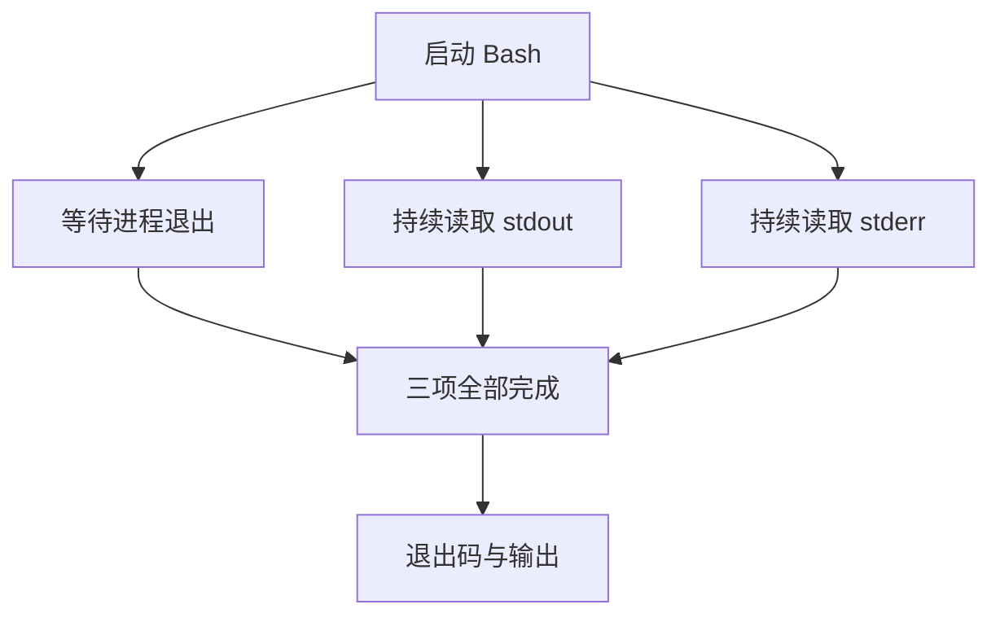

# 03：让测试作为一个真实进程运行

现在，文件可以读出来，也可以改回去。可改完以后，我们怎么知道它真的好了？

最直接的办法是运行项目自己的测试。这个动作和读文件有一点不同：文件操作完成就返回，测试进程却可能继续运行、不断打印文字，也可能迟迟不肯结束。

这一章给工具箱加上 `bash`。我们会先拿到一次普通命令的输出，再看输出太多、命令超时的时候，harness 该怎样收尾。

> 从 `step-02-file-tools` 继续，在练习目录应用 [03-bash.patch](patches/03-bash.patch)。新增实现仍放在 `src/tools.rs`，由同一个 `execute` 入口调用。

```bash
git apply --check "$CRABLOOP_SOURCE/tutorial/v1/patches/03-bash.patch"
git apply "$CRABLOOP_SOURCE/tutorial/v1/patches/03-bash.patch"
cargo test --locked --test tools bash_reports_exit_and_stderr -- --exact
```

`CRABLOOP_SOURCE` 的设置见[增量入口](patches/README.md)。本章实验都使用真实本地进程，无需调用模型。

## 打印了 ok，也可能执行失败

第一个测试执行的命令很短：`printf ok; printf problem >&2; exit 7`。它向 stdout 写入 `ok`，向 stderr 写入 `problem`，最后以退出码 7 结束。

工具把这些事实分别保存。这个实验期望的结果是：

```json
{
  "ok": false,
  "exit_code": 7,
  "stdout": "ok",
  "stderr": "problem",
  "timed_out": false,
  "truncated": false
}
```

如果只看 stdout 中的 `ok`，很容易得出错误结论。退出码和两路输出需要一起交给后面的模型；同样，stderr 有内容也不自动代表失败，命令本身的退出状态仍然要保留。

在 `src/tools.rs` 中，启动命令的代码是：

```rust
let mut child = tokio::process::Command::new("bash")
    .args(["-c", command])
    .current_dir(workspace)
    .stdin(Stdio::null())
    .stdout(Stdio::piped())
    .stderr(Stdio::piped())
    .kill_on_drop(true)
    .spawn()?;
```

我们明确使用 Bash，工作目录也明确交给 `current_dir`。stdin 关闭，避免命令一直等待额外输入；stdout 和 stderr 接成管道，便于收集。

`spawn()` 返回一个 `Child`。拿到这个句柄时，命令可能还没做完第一件事。接下来既要等待它结束，也要接住它的输出。

## 为什么“等它结束再读”会卡住

先想一种很自然的写法：启动命令，等待退出，最后读取输出。如果命令只打印几行，这种写法可能一直表现正常。

现在让命令持续往 stderr 写入内容。管道的容量有限，写满以后，进程必须等读者取走一些数据才能继续。可 Rust 程序还在等进程退出，根本没有开始读取。两边就这样互相等住了：


只读 stdout 也不能解决这个问题：stderr 仍然可能写满。因此，我们让等待退出和读取两路输出一起推进。

```rust
let out = child.stdout.take().context("stdout pipe missing")?;
let err = child.stderr.take().context("stderr pipe missing")?;
let (mut stdout, mut stderr) = (Vec::new(), Vec::new());
let completion = tokio::time::timeout(limits.bash_timeout, async {
    tokio::try_join!(
        child.wait(),
        drain(out, &mut stdout, limits.stream_bytes),
        drain(err, &mut stderr, limits.stream_bytes)
    )
})
.await;
```

`take()` 把两根管道的句柄从 `child` 中取出，分别交给 `drain`。`Child` 本身留下来等待进程退出。这次所有权转移有了很具体的用途：管道读取和进程等待可以同时向前走。

下面的三条分支都在同一个超时范围内。正常情况下，三者全部完成，工具才返回：



## 只保留一部分，也要继续读

接下来还有一个小陷阱。为了避免输出占满内存，我们只想保留前面一部分。如果达到配额就停止读管道，刚才的堵塞问题又会回来。

`drain` 因此把“读走”和“保存”分开。它不断读取小块字节，有剩余配额就放进缓冲区；配额用完以后继续读取，但不再扩大缓冲区。最后用 `truncated` 告诉模型，输出没有完整保留。

运行这个实验：

```bash
cargo test --locked --test tools bash_bounds_both_pipes_without_blocking_the_process -- --exact
```

测试让 stdout 和 stderr 各产生十万字节。每路最终只保留 4,096 字节，但命令仍然能够结束。这同时检查了内存限制和持续读取，而不仅是最后把长字符串截短。

## 期限到了，进程去了哪里

给等待加上超时，并不会凭空抹掉已经启动的进程。我们还要确认它是否退出；如果仍然活着，就显式调用 `kill().await`。`kill_on_drop(true)` 则负责句柄意外被丢弃时的兜底处理。

```bash
cargo test --locked --test tools bash_timeout_reaps_direct_child -- --exact
```

这个测试先让命令把 PID 写入文件，再执行 `exec sleep 10`。`exec` 把 Bash 替换成 sleep，因此我们仍在管理同一个直接子进程。测试给它很短的期限，返回后通过 PID 检查进程是否已经不存在。

还有一种更容易漏掉的情况：父进程退出了，后台后代却仍持有输出管道。只等待父进程退出，无法说明整个输出采集已经结束。

```bash
cargo test --locked --test tools bash_bounds_pipe_wait_after_parent_exit -- --exact
```

这也是为什么超时范围要覆盖图中的三条分支。如果已观察到父进程的退出码 0，但管道迟迟不结束，结果仍会标记 `timed_out`，不会把它报告成正常完成。这个小工具目前管理直接子进程，完整的后代进程树清理留给后续专题。

## 把进程事实交给下一轮

最后运行 `cargo test --locked --test tools bash_`，把本章的 Bash 实验一起检查一遍。

现在四个工具都能独立工作了。读文件可以返回内容，编辑可以返回成功或原因，Bash 可以返回退出码、两路输出和超时状态。它们还只是各自完成动作；接下来要让这些事实影响模型的下一步。

进入[第 04 章：把结果送回去，循环就开始了](04-agent-loop.md)。本章固定源码见 [`step-03-bash` 的 tools.rs](https://github.com/eriklee1895/crabloop/blob/step-03-bash/src/tools.rs)。
