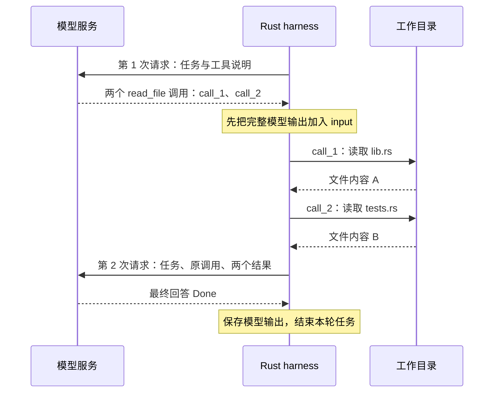
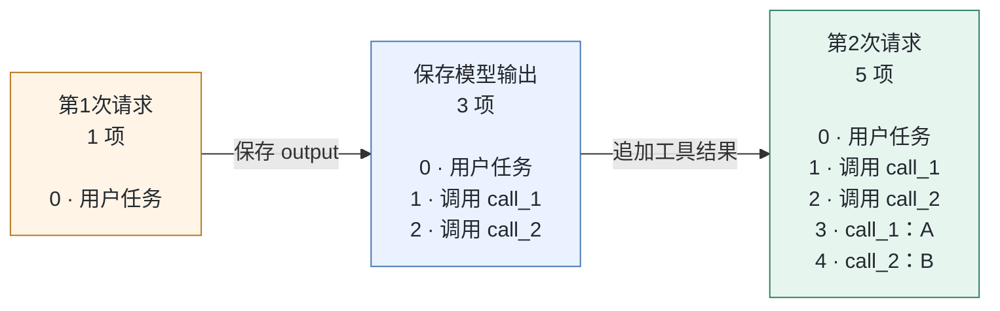

# 04：把结果送回去，循环就开始了

上一章结束时，四个工具已经能读文件、改代码和运行测试。现在给程序一个修复任务，模型也能提出第一步：先读 `lib.rs`，再读 `tests.rs`。

可是，读完以后呢？文件内容还停留在 Rust 程序手里。模型没有看见它们，自然也无从判断下一步该改哪里。我们还需要把这些新得到的事实送回去，让下一次请求接着上一次往下走。

这一章就来接通这条回路。先跟着两个文件走一趟，再故意弄断回传，看看循环会在哪儿露出问题。

> 本章从 `step-03-bash` 走到 `step-04-loop`，代码使用这一阶段的 `run`、`ModelClient` 和 `ToolResult`。当前 `milestone/v1` 已继续演进：`main` 保存连续提问的历史，`run_turn` 借用历史执行当前任务。这里先学清楚一个任务内部的循环，阶段接口在下一章收束。

## 先看一次小小的往返

为了把注意力放在循环上，我们先用一个本地实验。临时目录里只有两个待读取的文件：`lib.rs` 的内容是 `A`，`tests.rs` 的内容是 `B`。本地 HTTP 服务事先准备好两份响应：第一份要求读取这两个文件，第二份只回答 `Done`。

响应顺序是我们安排的，文件读取和 HTTP 请求则由程序真正执行。这样，无需配置模型密钥，也能反复观察同一条反馈通路。

在跟做前三章的练习目录中应用[本章完整增量](patches/04-agent-loop.patch)。`CRABLOOP_SOURCE` 指向参考仓库，设置方法见[增量入口](patches/README.md)。已经应用过 04 补丁时，直接运行测试即可。

```bash
git apply --check "$CRABLOOP_SOURCE/tutorial/v1/patches/04-agent-loop.patch"
git apply "$CRABLOOP_SOURCE/tutorial/v1/patches/04-agent-loop.patch"
cargo test --locked --test loop two_calls_then_final_preserves_ids_and_returns_both_results -- --exact --nocapture
```

运行时，留意 `turn 1: 2 tool call(s)` 和 `turn 2: 0 tool call(s)`：模型服务被请求了两次，两个文件工具都在这两次请求之间执行。

下面把这段过程展开。图中的模型服务是本地测试服务；箭头表示消息或调用的方向。



停在第二次请求的箭头上想一想：如果我们只在终端打印 `A` 和 `B`，却没有把它们放进请求里，模型会知道文件内容吗？终端输出是给人看的；下一次请求中的 `input`，才是模型这次会收到的历史。

## 让历史留在一个地方

打开练习工程的 `src/lib.rs`。新增的 `run` 函数先创建 HTTP 客户端、准备工具描述，再把用户任务放进一个数组：

```rust
let mut input = vec![json!({"role":"user", "content":config.task})];
```

这一刻，`input` 只有一项。它的类型是 `Vec<Value>`：同一个数组里既可以放用户消息，也可以放模型输出和工具结果。`run` 持有这个数组，整个任务运行期间它都在。

每轮请求都借用这份历史。下面摘出发送请求与保存响应的三行，省略预算检查和进度记录：

```rust
let request = client.request(INSTRUCTIONS, &input, &tools);
let reply = client.respond(request).await?;
input.extend(reply.output);
```

`&input` 把当前内容交给请求构造函数，数组仍留在 `run` 中。模型返回后，`extend` 把 `reply.output` 里的各项按顺序追加到末尾。

为什么先保存调用，再去执行工具？因为下一次请求不只需要“文件里是 A”，还需要知道这条结果回答了哪个调用。模型原来的调用和我们后来生成的结果，要一起留在历史里。

`reply.output` 还可能包含推理信息或中间说明。因此这里保存完整输出，而不只挑出 `function_call`。这些项会随历史一起传入后续请求。

## 把两个结果接到原来的调用上

模型把动作列出来之后，轮到 Rust 程序逐个执行。还是在 `src/lib.rs` 的 `run` 中，工具处理的关键代码是：

```rust
for call in reply.calls {
    let result = tools::execute(&call, &config.workspace, &config.limits).await;
    input.push(result.as_input());
}
```

`await` 等当前工具完成，再处理下一个调用。这里的两个 `read_file` 按顺序运行；两个结果都进入 `input` 以后，外层循环才会发出第二次模型请求。

`result.as_input()` 在 `src/tools.rs` 中，把执行结果转换成 Responses 接受的形式。以第一个文件为例，生成的这一项是：

```json
{
  "type": "function_call_output",
  "call_id": "call_1",
  "output": "{\"content\":\"A\",\"ok\":true,\"truncated\":false}"
}
```

外层的 `call_id` 指向原来的调用；`output` 是装着结果 JSON 的字符串。第二个调用也叫 `read_file`，但它的 `call_id` 是 `call_2`，内容是 `B`。工具名告诉我们做什么，`call_id` 告诉我们这份结果属于哪一次调用。

现在回头看 `input`，它从一项长成了五项。图中每个框按数组顺序列出内容，只展示这个实验实际出现的项：



打开 `tests/loop.rs` 中刚才运行的测试。它取出第二次请求的 `input`，检查长度为 5，并确认索引 3、4 的结果分别带着 `call_1`、`call_2`，解码后内容分别为 `A`、`B`。这个检查落在真正发出去的请求上，所以“终端看起来打印过结果”还不足以让它通过。

## 故意把回路断开一次

现在只在自己的练习副本中，把刚才的 `input.push(result.as_input());` 暂时注释掉，然后重新运行同一个测试：

```bash
cargo test --locked --test loop two_calls_then_final_preserves_ids_and_returns_both_results -- --exact --nocapture
```

预期测试失败：第二次请求只有用户任务和两个调用，共三项，缺少两个工具结果。文件仍然读过了，本地服务也仍会按安排回答 `Done`，但检查会在“历史应该有五项”的断言处拦住它。

这个实验把两个容易混在一起的事实分开了：工具确实执行过；模型下一轮是否收到了执行结果，还要检查请求。

恢复这行代码，再运行一次测试，确认重新通过后继续。

## 当工具没有做成，回路也要接着走

读文件成功时，结果里有内容。编辑失败时，结果里会有什么？我们用第二个实验追一遍。

临时文件 `lib.rs` 起初写着 `OLD`。本地服务先让 `edit_file` 把不存在的 `missing` 改成 `NEW`，再让它把真正存在的 `OLD` 改成 `NEW`，最后给出最终回答：

```bash
cargo test --locked --test loop tool_error_then_corrected_call_receives_actionable_feedback -- --exact --nocapture
```

第一次编辑找不到原文，会返回 `ok: false` 和 `old_text did not match; read the file again`。文件保持原样，错误结果仍然通过同一个 `input.push(...)` 进入历史。第二次编辑成功后，文件才变成 `NEW`。

这正是循环里值得保留的一点：可修正的工具错误也是反馈。它告诉模型当前动作为什么没有做成，让后续动作有机会调整。不要在这里一遇到 `ok: false` 就退出，也不要只把错误打印到终端。

本地服务的第二个动作是测试事先安排的。这个实验确认错误能够回传、后续工具能够继续执行；下一章才会让真实模型自己决定如何修正。

## 什么时候可以停下来

工具结果送回去以后，我们仍然要回答一个问题：下一轮是继续行动，还是已经可以结束？

`run` 在保存模型输出后做这个判断：

```rust
if reply.calls.is_empty() && reply.is_final {
    report.reason = StopReason::Final;
    report.final_text = reply.text;
    break;
}
```

两个条件都要满足。有工具调用，就先执行；只有中间说明 `commentary`、没有最终回答时，也继续下一轮。否则，一句“我先看一下文件”就可能被当成任务已经完成。

为了给迟迟不结束的任务留一个出口，`RunReport` 还区分另外两种停止原因：

| 停止原因 | 本轮观察到了什么 |
|---|---|
| `Final` | 没有待执行工具调用，且模型给出了最终回答 |
| `MaxTurns` | 已达到允许的模型调用轮数 |
| `ContextLimit` | 发请求前，整个请求 JSON 已超过字节预算 |

HTTP 或协议错误通过 `Result` 返回调用方；工具内部可修正的错误则像刚才那样进入历史。看清这两条路径，才知道错误发生后程序会退出，还是会给模型下一次机会。

运行本章全部测试：

```bash
cargo test --locked --test loop
```

除了两个文件和失败编辑，测试还会让模型服务连续返回中间说明，检查达到轮数上限后不再请求；也会把请求预算设得很小，检查第一次 HTTP 请求尚未发出就停止。字节预算约束的是整个请求体积，不是精确的 token 数。

## 带着这条回路去修一个真正的 bug

再沿两张图走一遍：第一次请求只有任务；模型提出动作；Rust 执行；原调用和结果一起留在历史；第二次请求因此多了可以使用的事实。一个 agent 开始根据环境反馈行动，就发生在这些具体的追加与调用之间。

合上源码，试着回答三个问题：只保存工具结果、丢掉原调用，会失去什么？模型一次提出三个工具调用时，下一次请求前要完成哪些事？如果测试失败了，模型却回答“修好了”，`Final` 能证明修复成功吗？

最后一个问题会带我们进入[第 05 章：让四个工具一起做完一件事](05-v1-coding-task.md)。那里会换成真实模型，并在循环之外检查文件与测试结果。

本章完整源码见 [`step-04-loop` 的 lib.rs](https://github.com/eriklee1895/crabloop/blob/step-04-loop/src/lib.rs)，本地实验见[同阶段的 tests/loop.rs](https://github.com/eriklee1895/crabloop/blob/step-04-loop/tests/loop.rs)。
