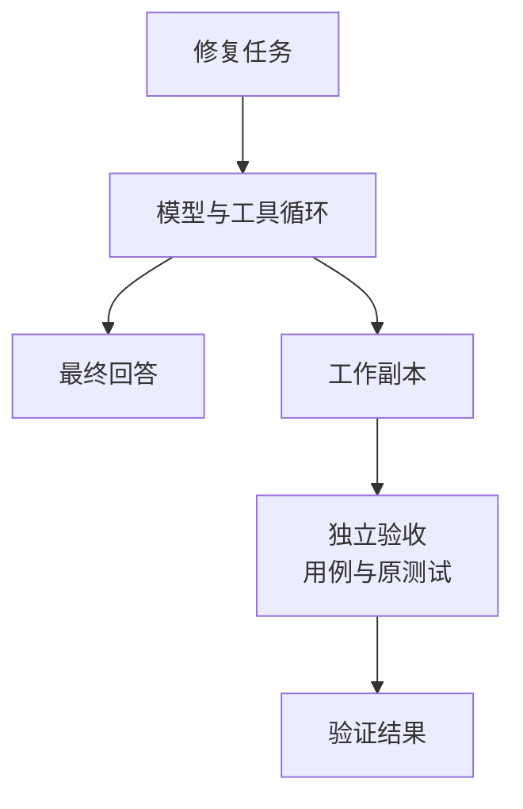
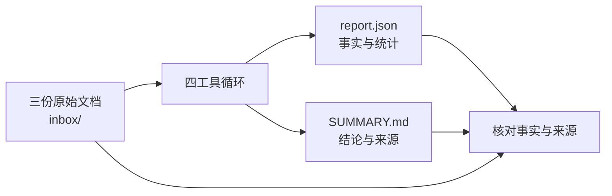

# 05：让四个工具一起做完一件事

上一章里，两个文件的内容顺利进入了第二次请求。现在把本地安排好的响应换成真实模型，让它在一个有 bug 的小项目里自己决定下一步。

不过，先别急着问它“修好了吗”。我们先准备一个无论模型怎么回答，都能在程序之外检查的标准。

## 先把练习工程走到当前 v1

本章从 `step-04-loop` 继续，应用综合任务与最终入口两个增量。下面命令在包含 `Cargo.toml` 的练习工程根目录执行，`CRABLOOP_SOURCE` 的设置见[增量入口](patches/README.md)：

```bash
git apply --check "$CRABLOOP_SOURCE/tutorial/v1/patches/05-v1.patch"
git apply "$CRABLOOP_SOURCE/tutorial/v1/patches/05-v1.patch"
git apply --check "$CRABLOOP_SOURCE/tutorial/v1/patches/06-v1-entry.patch"
git apply "$CRABLOOP_SOURCE/tutorial/v1/patches/06-v1-entry.patch"
cargo test --locked
```

已经应用过的增量不重复应用。05 补丁加入练习与独立验收，整理模型和工具接口；06 补丁接上当前 v1 的启动方式与最小连续对话。完成后，全部 `src` 文件与 `milestone/v1` 一致。

前几章为了逐步解释机制，使用过一些阶段接口。现在可以把它们与最终代码对照起来：

| 前几章的写法 | 当前 v1 的对应位置 |
|---|---|
| `ModelClient` 保存连接与配置 | `model::request`、`model::respond` 借用 `Config`，循环复用当次任务的 HTTP client |
| `ToolResult::as_input()` 包装结果 | 工具返回 JSON，循环追加带原 `call_id` 的 `function_call_output` |
| `run` 独自持有任务历史 | `main` 保存历史，`run_turn` 借用它处理当前任务；`run` 仍提供单任务包装 |
| 命令行参数传任务 | 从 stdin 读取，终端可连续提问，管道输入处理一次后退出 |

核心顺序没有变：请求、执行、回传、继续或停止。第 06 章会单独解释历史怎样跨用户提问保留下来，先用这一份实现完成两个任务。

## 先确认这个函数真的有错

`fixtures/buggy-rust/lib.rs` 中的 `last_index(len)` 应当在长度为零时返回 `None`，否则返回最后一个合法下标。初始版本却是：

```rust
pub fn last_index(len: usize) -> Option<usize> {
    Some(len)
}
```

长度为 1 时，它返回 1，但唯一的元素下标是 0。空集合则连一个合法下标都没有。先把练习材料复制到一个尚不存在的目录，再运行原有测试：

```bash
mkdir -p playground
cp -R fixtures/buggy-rust playground/my-first-repair
(
  cd playground/my-first-repair
  rustc --edition=2024 --test tests.rs -o checks
  ./checks
)
```

预期三个测试失败。这个失败是实验的起点；如果它们一开始就通过了，需要先确认是否误用了已经修好的副本。

再从练习工程根目录运行：

```bash
bash scripts/verify-playground.sh playground/my-first-repair
```

独立验收也应失败。它使用工作副本之外的测试，检查长度 0、1、10 和 `usize::MAX`。先看见失败，再把任务交给模型，后面的成功才有可比较的起点。

## 给它目标，观察它怎样行动

如果沿用第 01 章已经导出的 `OPENAI_API_KEY`、`OPENAI_BASE_URL` 和 `CRABLOOP_MODEL`，先显式选择兼容接口模式：

```bash
export CRABLOOP_PROVIDER=openai
```

这会继续使用你配置的端点、模型和匹配密钥。也可以按练习工程的 `.env.example` 配置 DeepSeek 默认模式。本章的二进制会从任务副本目录启动；使用 `.env` 时，文件应在那个启动目录，进程环境则会随目录切换保留。

接下来构建程序，并从待修复副本提交任务。括号内的目录切换结束后，会自动回到练习工程根目录：

```bash
cargo build --locked
crabloop_bin="$PWD/target/debug/crabloop"
(
  cd playground/my-first-repair
  printf '%s\n' "阅读 README.md，修复 last_index。先运行原有测试，再修改，再测试。保留函数签名和 tests.rs，写 NOTES.md 记录实际验证。" | "$crabloop_bin"
)
```

这一步会访问真实模型。运行时留意工具名、命令或路径、状态，以及每轮调用数量。模型可能先读测试，也可能把两个读取放在一轮；不必要求每次轨迹都长得相同。

值得追踪的是因果：测试返回了什么错误？下一次编辑是否回应了这个错误？编辑以后有没有重新运行测试？成功工具的正文不会全部回显到终端，但模型仍收到受大小限制的完整结果。

## 把“它说好了”和“我们检查过了”分别记下来

模型结束以后，在练习工程根目录执行：

```bash
bash scripts/verify-playground.sh playground/my-first-repair
cmp fixtures/buggy-rust/tests.rs playground/my-first-repair/tests.rs
```

第一条检查修复后的函数，第二条检查原测试是否被改动。`cmp` 正常通过时不输出内容，退出码为零。再打开 `NOTES.md`，核对里面提到的命令与结果。

整次实验有两条可以分别观察的线：



`Final` 说明模型结束了回答。修复是否成立，还要看右边这条经过文件和检查的路径。如果模型回答成功而验证失败，保留这个差异，重新检查它做过的动作；不要仅凭措辞替它判定成功。

仓库保留了[历史修复记录](../../evidence/v1/acceptance.md)与 [v1 验收证据](../../evidence/v1/ga-review.md)。它们记录各自当时的运行；你这次的结果，应以自己的文件和检查为准。

## 换一份材料，循环仍然相同

再做一个不需要改程序的任务。`fixtures/local-report/inbox` 中有三份小文档，记录负责人和状态。目标是整理成 `report.json`，并生成一份带来源的 `SUMMARY.md`。



保持在练习工程根目录，沿用配置好的进程环境，准备另一个尚不存在的副本：

```bash
cp -R fixtures/local-report playground/my-first-report
cargo build --locked
crabloop_bin="$PWD/target/debug/crabloop"
(
  cd playground/my-first-report
  printf '%s\n' "按 README.md 阅读全部 inbox 文档，生成 report.json 和带来源的 SUMMARY.md，保留原始资料，核对事实后结束。" | "$crabloop_bin"
)
python3 scripts/verify-report.py playground/my-first-report
```

验证脚本核对必需字段、统计数字、来源路径和原始资料是否保持不变。中文总结写得是否准确、清楚，仍要读一遍确认。

这里还有一个有用的小实验：验证器允许正确的额外 `total`，却会拒绝错误统计或被修改的原始资料。运行它自己的测试，看看“多写一个正确字段”和“写错事实”是怎样区分的：

```bash
python3 -m unittest discover -s tests -p 'verify_report_test.py'
```

验收条件应当来自任务目标。检查得越严格，并不自动意味着检查得越正确。

## 回头看这一个循环

修代码时，反馈可能是测试失败；整理资料时，反馈可能是缺失字段或来源不匹配。它们都经过同一条路：读出事实、执行动作、把结果交回去，再检查最终产物。

下一步，如果想接着问“刚才为什么这样改”，历史该放在哪里？进入[第 06 章：让一个任务接着另一个任务](06-conversation.md)，拆开当前 v1 中那层很小的外循环。
