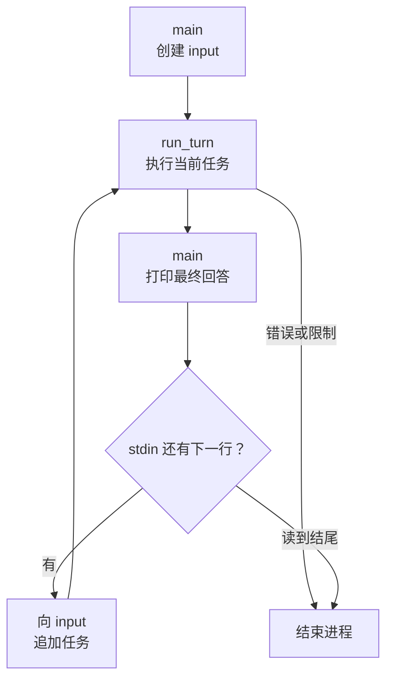

# 06：让一个任务接着另一个任务

上一章已经拿到了 v1 的完整实现。现在从修复任务往后走一句：如果我们问“刚才为什么这样改”，程序要怎样接住这个“刚才”？

这次不需要增加任何功能代码。上一章写下的 `main` 已经能做到这件事；我们要做的，是看清它为什么能做到，再用一个测试把这种能力固定下来。

## 先试着接着问一句

沿用第 01 章的三个环境变量，在一个可以随意写文件的空目录里启动程序。下面是一组手动练习输入，会访问真实模型；它不是某次运行的转录：

```bash
mkdir -p playground/breakfast
(cd playground/breakfast && cargo run --locked --quiet --manifest-path ../../Cargo.toml)
```

```text
crab> 创建 note.txt，写入三种适合周末做的早餐。
crab> 把刚才第二种换成一道素食早餐，再读回来检查。
```

第一轮回答以后，`crab>` 会再次出现。第二句话没有重新介绍 `note.txt`，却提到了“刚才第二种”。即使模型决定再读一次文件，前面的任务、调用和回答仍然是理解这句话的重要背景。

完成后，在空输入行按 Ctrl-D 退出。先把“程序还在等待下一句话”和“模型还在执行当前任务”区分开，我们马上就会在代码里看到两层循环。

## 历史放到谁手里，决定它能活多久

第 04 章的 `run_turn` 不拥有历史，它的签名是：

```rust
pub async fn run_turn(config: &Config, input: &mut Vec<Value>) -> Result<Stop> {
```

`&mut` 让这一轮能够向历史追加内容；函数返回时，数组仍然留在调用者手里。那么调用者是谁、它把数组放在哪里，就决定了历史能活多久。

回到 `src/main.rs`，先找到 `input` 的创建位置，再顺着 `for` 循环看它怎样被反复使用：

```rust
let config = Config::from_env()?;
let mut input = Vec::new();

eprint!("crab> ");
for line in std::io::stdin().lock().lines() {
    let task = line?;
    if !task.trim().is_empty() {
        input.push(serde_json::json!({"role": "user", "content": task}));
        match run_turn(&config, &mut input).await? {
            Stop::Final(text) => println!("{text}"),
            stop => {
                eprintln!("stopped: {stop:?}");
                return Ok(ExitCode::from(2));
            }
        }
    }
    eprint!("crab> ");
}
```

最关键的位置是：`input` 创建在 `for` 循环之前。每次调用 `run_turn`，传入的是同一个数组；读到下一行任务，追加一条 `user` 消息，再进入下一轮。

把这段控制流画出来，就能看出两层循环各自在等什么：



内层循环在 `run_turn` 里，等待模型和工具；外层循环在 `main` 里，一轮完成后等待用户。一次用户任务可能触发多次模型请求，不要把这两个次数混在一起：`max_turns` 限制的是每个任务的模型请求次数，每次调用 `run_turn` 都重新计数。

## 上一轮的最终回答也要留下来

如果只保存工具调用，却忘了保存最终回答，会怎样？用户可能追问“你刚才提到的第二点是什么”，但下一次请求里没有那段回答。

`run_turn` 先把完整模型输出加入历史，再判断是否最终结束：

```rust
input.extend(reply.output);
if reply.calls.is_empty()
    && let Some(text) = reply.final_text
{
    return Ok(Stop::Final(text));
}
```

所以上一轮的最终回答会和工具结果一起留下来。应用本章补丁，它只增加两个测试：

```bash
git apply --check "$CRABLOOP_SOURCE/tutorial/v1/patches/06-conversation.patch"
git apply "$CRABLOOP_SOURCE/tutorial/v1/patches/06-conversation.patch"
cargo test --locked --test loop followup_replays_previous_answer_and_complete_tool_results -- --exact
```

这个测试直接调用两次 `run_turn`。第一次安排模型读取两个文件，再返回 `Done`；随后追加一个追问。第二个用户任务发出的第一份请求，也就是整个实验的第三次模型请求，携带的历史顺序如下：

```text
0  第一条用户任务
1  read_file 调用 call_1
2  read_file 调用 call_2
3  call_1 的工具结果：A
4  call_2 的工具结果：B
5  第一轮最终回答：Done
6  新的用户追问
```

测试同时检查前一轮的回答与工具结果，确认它们没有在函数返回时丢失。

## 故意让历史只活一轮

另一个测试从外面检查同一件事：它真正启动编译好的程序，从 stdin 送进三行，`first`、一个空行、`second`：

```bash
cargo test --locked --test cli each_stdin_line_is_a_task_and_history_is_kept -- --exact
```

它期望 stdout 恰好是两行 `Done`：空行不会触发请求；发给 `second` 的那次请求里，排在前面的是 `first` 和第一轮的回答 `Done`。

现在只在自己的练习副本中，把 `src/main.rs` 里的 `let mut input = Vec::new();` 移进 `for` 循环，放在 `let task = line?;` 下面，再运行同一个测试。

预期测试失败：第二次请求的第一项变成了 `second`，前面的任务和回答都不见了。程序照样回答了两次，单看终端输出很难发现区别；是请求里的历史告诉我们，第二个任务失去了“刚才”。

把这行移回循环外，确认测试重新通过。一行代码的位置，决定了历史是只活一轮，还是活到 stdin 结束。

## 终端输入和管道输入，走的是同一条路

`main` 不区分自己是连在终端上还是连在管道上，两种情况都是“逐行读取，每个非空行一个任务”。在终端里，按 Enter 提交一行，Ctrl-D 表示没有下一行；在管道里，文件结尾就是 Ctrl-D：

```bash
printf '%s\n' "读取 Cargo.toml，告诉我包名" "它依赖哪几个 crate？" | cargo run --locked --quiet
```

这两行会成为两轮对话，第二轮能看到第一轮。反过来，一个任务也必须写在一行里；需要多行说明时，把要求写进文件，再让任务去读它，就像第 05 章的 `README.md`。

## 留下历史以后，下一个问题出现了

当前历史只保存在内存中。退出进程以后，它不会自动恢复；已经写到磁盘的文件仍然存在。模型或协议错误、轮数上限、请求预算用尽都会结束当前进程，需要先检查文件状态再决定下一步。

更长的对话还有一个自然结果：每轮发送的历史越来越多。代码读了一遍，测试跑了几轮，又追加了几条追问，早期内容是否还要全部发送？请求预算迟早会触发 `ContextLimit`。

到这里，v1 的学习路线就完整了：从一次请求，到四个工具，到行动循环，再到同一进程里的连续任务。下一阶段计划在 main 从这份 v1 逐步增加 context 与 compaction，研究怎样在保留必要事实的同时整理历史；验收后再创建 milestone/v2。旧版 [v2 教程](https://github.com/eriklee1895/crabloop/tree/v2/tutorial/v2)仅作历史参考。
