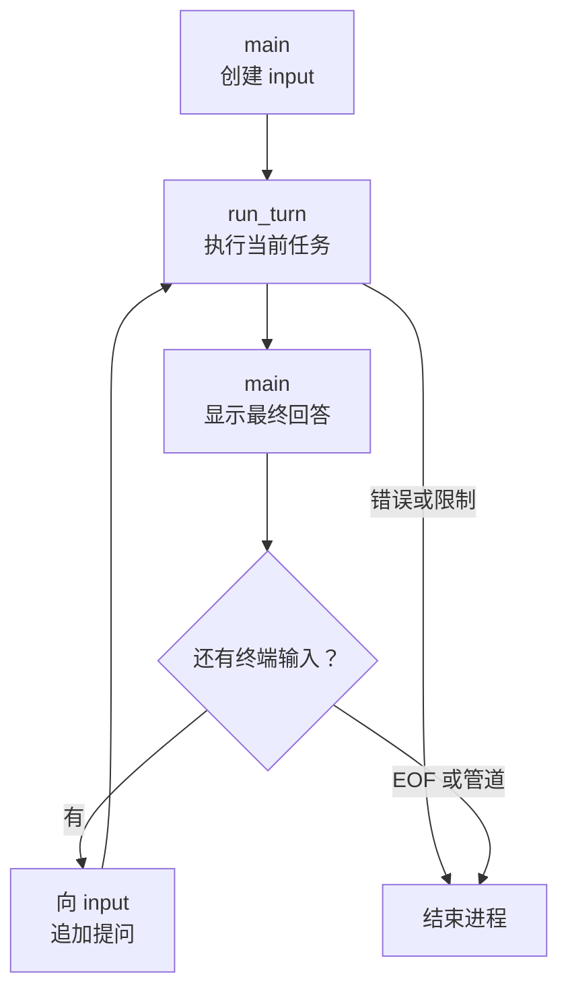

# 06：让一个任务接着另一个任务

上一章已经拿到了当前 v1 的完整实现。现在从修复任务往后走一句：如果我们问“刚才为什么这样改”，程序要怎样接住这个“刚才”？

这次不需要增加工具。我们要改变的是历史的寿命：一轮任务结束以后，把它留下来，再接上用户的下一句话。

> 本章直接阅读完成 `06-v1-entry.patch` 后的当前 v1。它使用 `main`、`cli::read_task` 和 `run_turn`，没有额外的 `Session` 类型，也没有摘要压缩或持久化。

## 先试着接着问一句

按 [v1 README](https://github.com/eriklee1895/crabloop/blob/milestone/v1/README.md) 配好模型，在终端启动 `cargo run`。下面是一组手动练习输入，会访问真实模型；它不是某次运行的转录：

```text
crab> 创建 note.txt，写入三种适合周末做的早餐。
crab> 把刚才第二种换成一道素食早餐，再读回来检查。
```

第一轮回答以后，`crab>` 会再次出现。第二句话没有重新介绍 `note.txt`，却提到了“刚才第二种”。即使模型决定再读一次文件，前面的任务、调用和回答仍然是理解这句话的重要背景。

完成后，在空输入行按 Ctrl-D 退出。先把“程序还在等待下一句话”和“模型还在执行当前任务”区分开，我们马上就会在代码里看到两层循环。

## 历史放到谁手里，决定它能活多久

第 04 章的 `run` 自己创建 `input`。一次调用返回后，这个局部变量就离开了作用域。要让下一条用户输入接着使用它，我们把保存历史的职责放到 `main`，再把可变借用交给内层：

```rust
pub async fn run_turn(
    config: &Config,
    input: &mut Vec<serde_json::Value>,
) -> anyhow::Result<RunReport> {
```

这是 `src/lib.rs` 中的函数签名，函数体仍然是熟悉的请求、执行、回传循环。`&mut` 让这一轮能够向历史追加内容；函数返回时，拥有数组的 `main` 仍然保留它。

`run(Config)` 也还在，方便只需要处理一次任务的调用者和测试使用。它创建一个新的数组，再调用 `run_turn`。终端的连续对话则直接复用外层数组。

下面是当前 `src/main.rs` 的完整入口。先找到 `input` 的创建位置，再顺着 `loop` 看它怎样被反复使用：

```rust
use crabloop::{StopReason, cli, run_turn};
use std::io::IsTerminal;

#[tokio::main]
async fn main() -> anyhow::Result<()> {
    let chat = std::io::stdin().is_terminal();
    let Some(config) = cli::load(&std::env::args().collect::<Vec<_>>())? else {
        return Ok(());
    };
    let mut input = vec![serde_json::json!({"role":"user","content":config.task})];

    loop {
        let report = run_turn(&config, &mut input).await?;
        println!("{}", report.final_text);
        eprintln!("stop: {:?}; model turns: {}", report.reason, report.model_turns);
        if report.reason != StopReason::Final {
            std::process::exit(2);
        }
        if !chat {
            break;
        }
        let Some(task) = cli::read_task(config.limits.request_bytes)? else {
            break;
        };
        input.push(serde_json::json!({"role":"user","content":task}));
    }
    Ok(())
}
```

这里最关键的位置是：`input` 创建在外层循环之前。每次调用 `run_turn`，传入的是同一个数组；收到下一条任务后，追加一条 `user` 消息，再进入下一轮。

把这段控制流画出来，就能看出两层循环各自在等什么：



内层循环等待模型和工具；外层在一轮完成后等待用户。一次用户提问可能触发多次模型请求，不要把这两个次数混在一起。

## 上一轮的最终回答也要留下来

如果只保存工具调用，却忘了保存最终回答，会怎样？用户可能追问“你刚才提到的第二点是什么”，但下一次请求里没有那段回答。

因此 `run_turn` 先把完整模型输出加入历史，再判断是否最终结束：

```rust
input.extend(reply.output);
if reply.calls.is_empty() && reply.is_final {
    report.reason = StopReason::Final;
    report.final_text = reply.text;
    break;
}
```

上一轮的最终回答会和工具结果一起留下来。运行下面这个本地实验，直接检查第二次提问发出去的历史：

```bash
cargo test --locked --test loop followup_replays_previous_answer_and_complete_tool_results -- --exact
```

测试先安排模型读取两个文件，再返回 `Done`；随后追加一个追问。第二个用户回合发出的第一份请求，也就是整个实验的第三次模型请求，携带的历史顺序如下：

```text
0  第一条用户任务
1  read_file 调用 call_1
2  read_file 调用 call_2
3  call_1 的工具结果：A
4  call_2 的工具结果：B
5  第一轮最终回答：Done
6  新的用户追问
```

测试同时检查前一轮的回答与工具结果，确认它们没有在函数返回时丢失。第一条用户任务用了两次模型请求，第二条用了一次；`model_turns` 在每次 `run_turn` 中重新计数。

这个实验检验历史如何发送，模型服务的回答是事先安排好的。真实模型能否正确理解追问，还要结合前面的手动练习观察。

## 终端输入和管道输入，各自怎样结束

`cli::read_task` 通过 `stdin.is_terminal()` 区分两种情况。

在终端里，它显示提示符、读取一行；空行会继续等待，Ctrl-D 表示没有下一条输入。在管道里，它读取完整内容，作为一次任务提交，处理结束后退出：

```bash
printf '%s\n' "读取 README.md，概括项目结构" | cargo run --quiet
```

所以，把两行文本一起通过普通管道传入，会得到一条多行任务，不是两轮聊天。

还有一项测试会真正启动二进制，把它连到伪终端，依次输入首问、空行和追问，最后发送 Ctrl-D：

```bash
python3 -m unittest discover -s tests -p 'chat_test.py'
```

这验证了提示符再次出现、空行没有发送请求、追问保留历史以及进程正常退出。文件与工具反馈的保留则由前面的 Rust 测试检查。

## 留下历史以后，下一个问题出现了

当前历史只保存在内存中。退出进程以后，它不会自动恢复；已经写到磁盘的文件仍然存在。模型或协议错误、轮数上限、请求预算用尽都会结束当前进程，需要先检查文件状态再决定下一步。

更长的对话还有一个自然结果：每轮发送的历史越来越多。代码读了一遍，测试跑了几轮，又追加了几条追问，早期内容是否还要全部发送？

到这里，v1 的学习路线就完整了：从一次请求，到四个工具，到行动循环，再到同一进程里的连续提问。下一阶段进入 [v2 的上下文管理](https://github.com/eriklee1895/crabloop/tree/v2/tutorial/v2)，研究怎样在保留必要事实的同时整理历史。按 v2 各章指定的代码基线继续即可。
